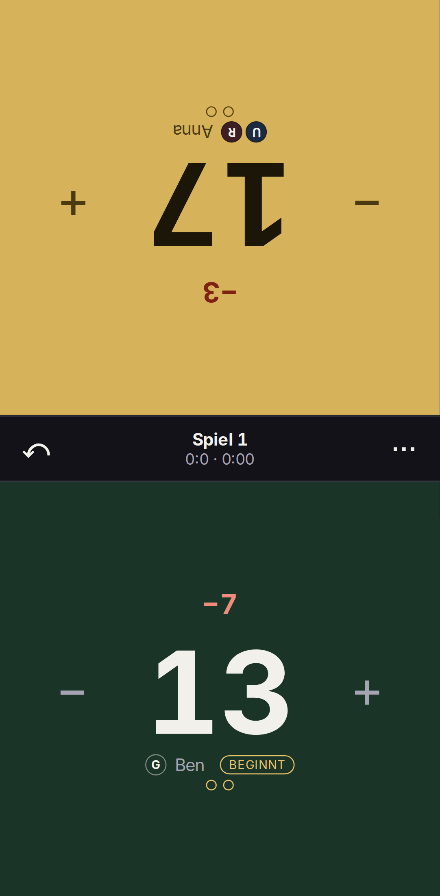
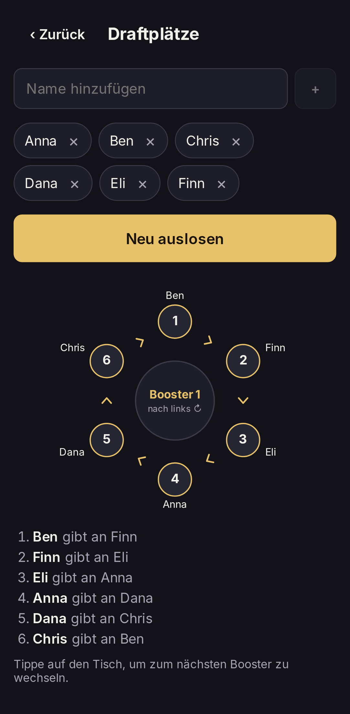
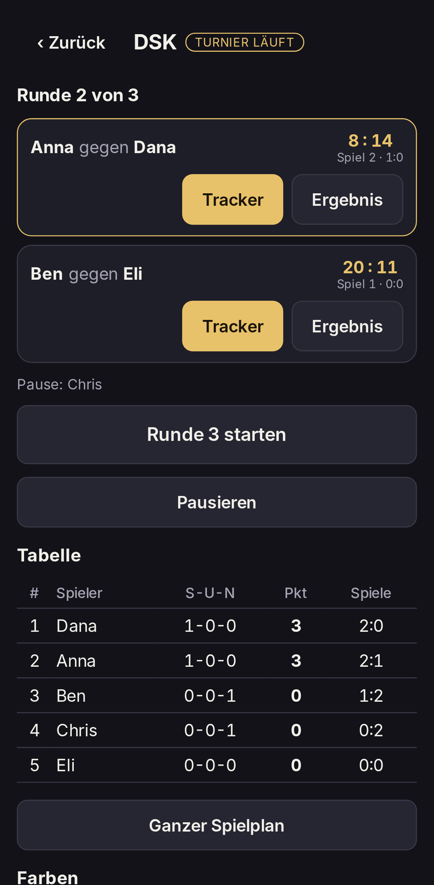
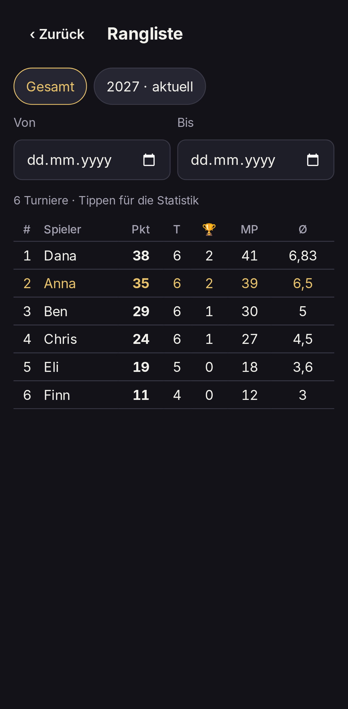
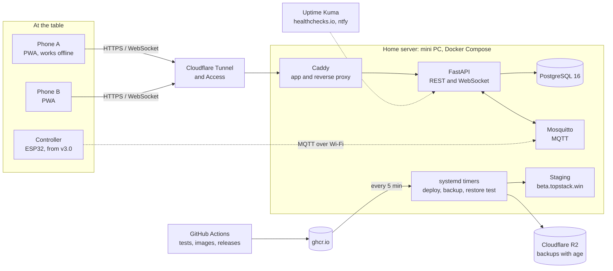

# TopStack

[Deutsch](README.md) · **English**

A self-hosted app for Magic: The Gathering play groups. At the table it tracks life totals on every phone, even without internet. Afterwards it runs the draft tournament and keeps a long-term leaderboard, live for everyone at the table.

[](https://github.com/krauspeter/topstack/actions/workflows/ci.yml)
[](https://github.com/krauspeter/topstack/releases)
[](LICENSE)

<p align="center">
  
  
  
  
</p>
<p align="center"><sub>Life tracker · table view · live view · leaderboard (made-up data, generated with Playwright; the UI is in German)</sub></p>

## Features

- **Life tracker:** best-of-3 with a d20 roll for who starts; tap ±1, hold ±5, undo, time limit with 5 extra turns. One shared phone or two paired phones. Works offline and keeps the screen on.
- **Draft tournaments:** invite players by link or QR code, guests need no account. Draft seats are drawn at random, and a table view shows the passing direction per booster. Round robin with a schedule, matches can be pulled forward. Results can be corrected, a cancellation needs a vote, and there is an award ceremony.
- **Live:** life totals, running matches and standings reach every device in under 2 seconds (WebSocket). Web push for "your turn", new round and tournament end.
- **Leaderboard and statistics:** points by placement, filters by season and date range. Win rates, head-to-head, and records with your own colours and against your opponents' colours.
- **Feedback:** bugs and wishes straight from the app; the server turns them into anonymised GitHub issues.

Planned (see [roadmap](#roadmap)): multiple groups and historic data, scheduling polls, Sealed, Constructed with Swiss pairings, Commander, AI summaries and a dedicated ESP32 controller.

## Architecture



- **Offline first:** life changes are immutable events with a device UUID. They are stored in IndexedDB first and synced to the server idempotently ([ADR-0005](docs/adr/0005-ereignisse-offline-first.md), [ADR-0012](docs/adr/0012-sync-app-server.md)).
- **Framework-free domain logic:** schedule, tiebreakers, ranking points and seat draw are pure functions in `server/topstack/domain/`, each with its own tests.
- **No open ports:** access from outside only goes through a Cloudflare Tunnel; staging also sits behind Cloudflare Access.

More: [architecture](docs/architektur.md) · [data model](docs/datenmodell.md) · [interfaces](docs/schnittstellen.md) (in German)

## Tech stack

| Area | Technology |
| --- | --- |
| App | React 18, TypeScript, Vite, PWA (vite-plugin-pwa), IndexedDB with Dexie, Web Push, passkeys (WebAuthn) |
| Backend | Python 3.12, FastAPI, SQLAlchemy 2 (async), Alembic, PostgreSQL 16, WebSocket, MQTT |
| Firmware | ESP32, PlatformIO, Unity tests without hardware |
| Operations | Docker Compose, Caddy, Cloudflare Tunnel and Access, systemd timers, Cloudflare R2, age, Uptime Kuma, healthchecks.io, ntfy |
| CI/CD | GitHub Actions, ghcr.io, Dependabot, pre-commit, Semantic Versioning with automatic releases |
| Tests | pytest against real PostgreSQL, Vitest, Playwright (emulated iPhone and Android), shellcheck |

## Architecture decisions

Every major decision is recorded as an ADR with context, alternatives and consequences in [`docs/adr/`](docs/adr) (in German):

| ADR | Decision |
| --- | --- |
| [0001](docs/adr/0001-adrs-verwenden.md) | Record architecture decisions as ADRs |
| [0002](docs/adr/0002-monorepo.md) | Monorepo with app, server, firmware, docs |
| [0003](docs/adr/0003-frontend-react-pwa.md) | Frontend as a React PWA with TypeScript and Vite |
| [0004](docs/adr/0004-backend-fastapi-postgres.md) | Backend with FastAPI and PostgreSQL |
| [0005](docs/adr/0005-ereignisse-offline-first.md) | Life totals as events, offline first |
| [0006](docs/adr/0006-live-websocket-mqtt.md) | Live data over WebSocket, controller over MQTT |
| [0007](docs/adr/0007-betrieb-minipc-docker.md) | Run on a mini PC with Docker Compose, Caddy and Cloudflare Tunnel |
| [0008](docs/adr/0008-anmeldung-passkey-magic-link.md) | Sign-in with passkey and magic link |
| [0009](docs/adr/0009-oeffentliches-repo.md) | Public repository under the MIT licence |
| [0010](docs/adr/0010-mehrgruppen-datenmodell.md) | Multi-group data model from v1.0 |
| [0011](docs/adr/0011-visuelles-design.md) | Visual design "Dark & Gold" |
| [0012](docs/adr/0012-sync-app-server.md) | Synchronisation between app and server |
| [0013](docs/adr/0013-turnier-zustaende.md) | Tournament states and permissions |
| [0014](docs/adr/0014-persistenz-und-tests.md) | Database access, migrations and tests against real PostgreSQL |
| [0015](docs/adr/0015-spieler-ohne-konto.md) | Players without an account |
| [0016](docs/adr/0016-betrieb-backup-monitoring-deployment.md) | Backups, monitoring and deployment on the home server |
| [0017](docs/adr/0017-staging.md) | Staging environment `beta.topstack.win` |

## Tests and CI

Every pull request runs only the parts it touches in GitHub Actions:

- **Backend:** about 200 pytest tests against real PostgreSQL 16, Ruff, `alembic check` and a comparison of the migrated database with [`docs/schema.sql`](docs/schema.sql).
- **App:** lint, type check, about 60 Vitest unit tests and about 45 Playwright end-to-end tests in iPhone and Android emulation.
- **Operations:** the whole stack starts in Docker. The checks cover backup and restore, the health check without a database, deployment with a deliberately broken image (rollback) and staging next to production.
- **Images:** ghcr.io gets `main` after every merge and `pr-<number>` for pull requests. A release only adds tags, nothing is rebuilt.

Locally, the same checks run as pre-commit hooks before every commit and push.

## Operations

| Environment | Address | Runs |
| --- | --- | --- |
| Production | `topstack.win` | latest release (`latest`), `main` until v1.0 |
| Staging | `beta.topstack.win` | every merge into `main`, or a pull request on request |

- **Deployment:** a systemd timer pulls new images every 5 minutes. It takes a backup first, rolls back on failure and remembers the broken state. A lock pauses updates during game nights. A release is a normal PR prepared by `scripts/release.sh` ([changelog](CHANGELOG.md)).
- **Backups:** nightly `pg_dump`, kept for 7 days, 4 weeks and 6 months. A copy encrypted with `age` goes to Cloudflare R2. A monthly restore test runs automatically, and a restore on a second machine has already been rehearsed.
- **Monitoring:** Uptime Kuma on the home server, healthchecks.io as an outside watchdog, alerts to the phone via ntfy.

**Known limitation:** the app has not been tested on a real iPhone yet, only in iPhone emulation. The test follows after v1.0.

Guides (in German): [set up the home server](docs/phase3/heimserver.md) · [phase 4: beta and operations](docs/phase4/README.md)

## Roadmap

| Version | Scope | Status |
| --- | --- | --- |
| v1.0 | Draft tournaments for our own group, operations with backups, monitoring, deployment | in progress, release end of 2026 |
| v1.1 | Multiple groups, import of historic data, Elo, head-to-head, awards, table mode | planned |
| v1.2 | Scheduling polls for game nights, shared expenses | planned |
| v1.3 / v1.4 | Sealed; Constructed with Swiss pairings and top cut | planned |
| v2.0 | English and Portuguese, extended statistics, AI summary and prediction | planned |
| v2.1 | Commander with 3 to 6 players | planned |
| v3.0 / v3.1 | ESP32 controller; redesign and brand | planned |
| v4.0 | Public launch, apps in the App Store and Google Play | planned |

## Repository layout

| Folder | Contents |
| --- | --- |
| [`app/`](app) | PWA: React, TypeScript, Vite, works offline |
| [`server/`](server) | Backend: FastAPI, PostgreSQL; domain logic in `topstack/domain/` |
| [`firmware/`](firmware) | Controller: ESP32, PlatformIO, Unity tests |
| [`infra/`](infra) | Docker Compose, Caddy, Mosquitto, scripts for backup, deployment and staging |
| [`docs/`](docs) | Architecture, data model, interfaces, ADRs, phase plans |
| [`scripts/`](scripts) | Release, switching staging, push with live CI output |

## Local development

```bash
# Backend
cd server
python -m venv .venv && source .venv/bin/activate
pip install -e ".[dev]"
pytest
uvicorn topstack.main:app --reload      # http://localhost:8000/api/v1/docs

# App (second terminal)
cd app
npm install
npm run dev                              # http://localhost:5173, /api goes to :8000

# Firmware logic without hardware
cd firmware
pio test -e native
```

Before pushing: `pip install pre-commit && pre-commit install` (once), then `bash scripts/push.sh`. The script pushes and shows the CI run live in the terminal.

To regenerate the screenshots, start the **Screenshots** workflow in GitHub Actions on your branch. It also works locally: `cd app && SCREENSHOTS=1 npx playwright test screenshots --project=android`.

## License

MIT, see [LICENSE](LICENSE). TopStack is a fan project and is not affiliated with Wizards of the Coast.
