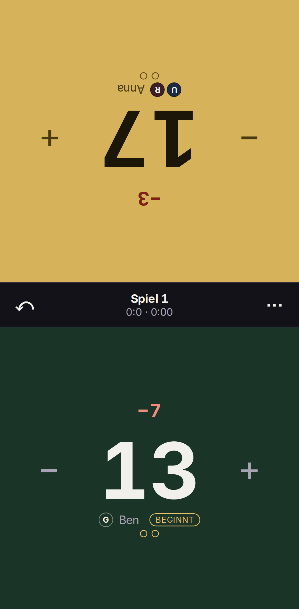
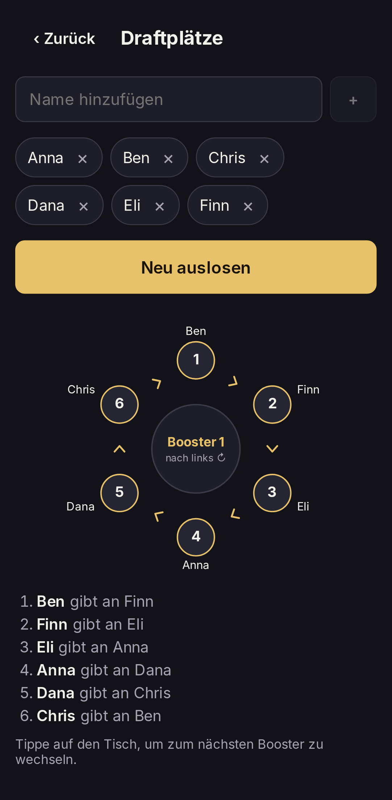
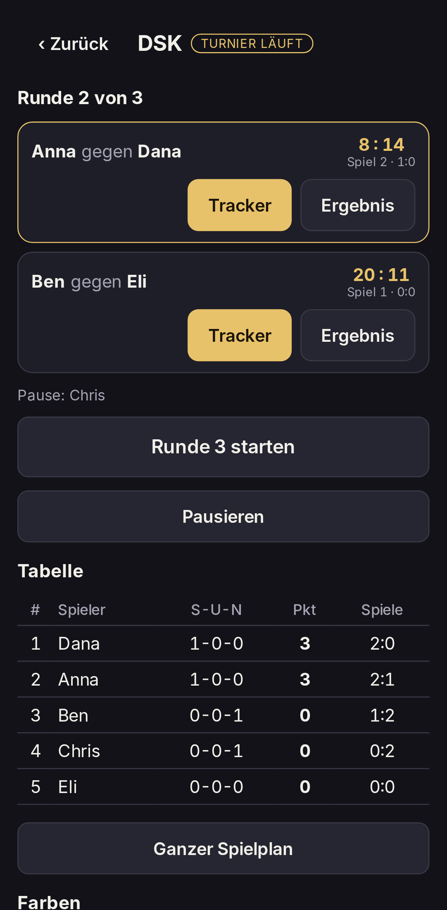
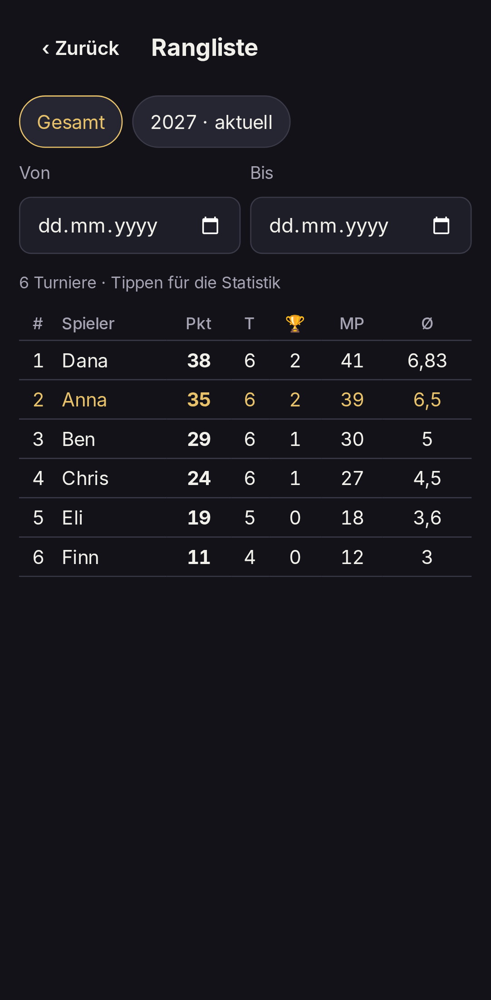
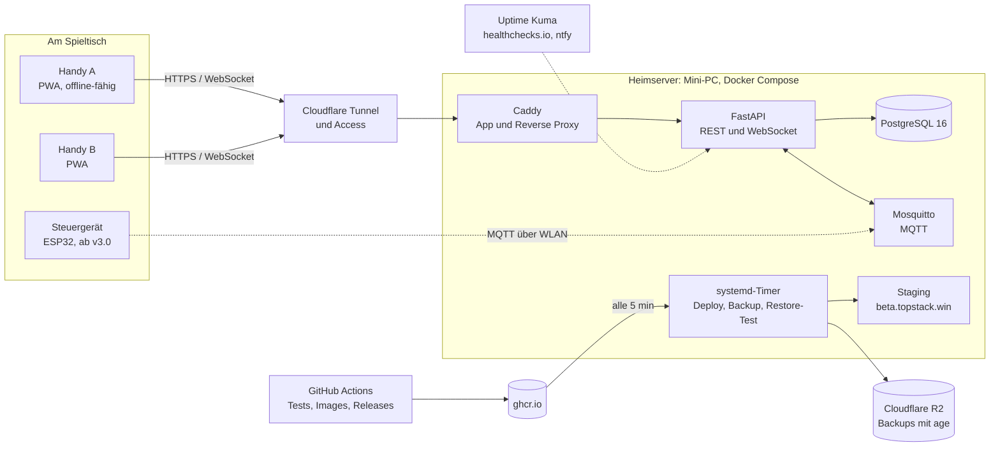

# TopStack

**Deutsch** · [English](README.en.md)

Selbst gehostete App für Magic-Spielgruppen: Am Tisch zählt sie die Lebenspunkte auf jedem Handy, auch ohne Internet. Danach führt sie durch das Draft-Turnier und pflegt eine dauerhafte Rangliste, live für alle am Tisch.

[](https://github.com/krauspeter/topstack/actions/workflows/ci.yml)
[](https://github.com/krauspeter/topstack/releases)
[](LICENSE)

<p align="center">
  
  
  
  
</p>
<p align="center"><sub>Life-Tracker · Tischgrafik · Live-Ansicht · Rangliste (Daten erfunden, erzeugt mit Playwright)</sub></p>

## Funktionen

- **Life-Tracker:** Best-of-3 mit W20-Wurf, wer beginnt; Tippen ±1, Halten ±5, Rückgängig, Zeitlimit mit 5 Extra-Zügen. Ein gemeinsames Handy oder zwei gekoppelte Handys. Läuft offline, der Bildschirm bleibt an.
- **Draft-Turniere:** Spieler einladen per Link oder QR-Code, Gäste ohne Konto. Draftplätze werden ausgelost, eine Tischgrafik zeigt die Passrichtung je Booster. Jeder gegen jeden mit Spielplan, Matches lassen sich vorziehen. Ergebnisse mit Korrektur, Abbruch per Abstimmung, Siegerehrung.
- **Live:** Lebenspunkte, laufende Matches und die Tabelle erscheinen in unter 2 Sekunden auf allen Geräten (WebSocket). Web-Push bei „Du bist dran“, neuer Runde und Turnierende.
- **Rangliste und Statistik:** Punkte nach Platzierung, Filter nach Saison und Zeitraum. Siegquoten, Head-to-Head, Farbbilanz mit den eigenen Farben und gegen die Farben der Gegner.
- **Feedback:** Fehler und Wünsche direkt aus der App; der Server legt daraus anonymisierte GitHub-Issues an.

Geplant (siehe [Roadmap](#roadmap)): mehrere Gruppen und Altdaten, Terminumfrage, Sealed, Constructed mit Schweizer System, Commander, KI-Zusammenfassungen und ein eigenes Steuergerät mit ESP32.

## Architektur



- **Offline zuerst:** Lebenspunkte sind unveränderliche Ereignisse mit Geräte-UUID. Sie liegen zuerst in IndexedDB und werden idempotent mit dem Server abgeglichen ([ADR-0005](docs/adr/0005-ereignisse-offline-first.md), [ADR-0012](docs/adr/0012-sync-app-server.md)).
- **Domänenlogik ohne Framework:** Spielplan, Tiebreaker, Ranglistenpunkte und Auslosung sind reine Funktionen in `server/topstack/domain/`, einzeln getestet.
- **Keine offenen Ports:** Der Zugriff von außen läuft nur über einen Cloudflare Tunnel; Staging ist zusätzlich hinter Cloudflare Access.

Mehr dazu: [Architektur](docs/architektur.md) · [Datenmodell](docs/datenmodell.md) · [Schnittstellen](docs/schnittstellen.md)

## Tech-Stack

| Bereich | Technik |
| --- | --- |
| App | React 18, TypeScript, Vite, PWA (vite-plugin-pwa), IndexedDB mit Dexie, Web Push, Passkeys (WebAuthn) |
| Backend | Python 3.12, FastAPI, SQLAlchemy 2 (async), Alembic, PostgreSQL 16, WebSocket, MQTT |
| Firmware | ESP32, PlatformIO, Unity-Tests ohne Hardware |
| Betrieb | Docker Compose, Caddy, Cloudflare Tunnel und Access, systemd-Timer, Cloudflare R2, age, Uptime Kuma, healthchecks.io, ntfy |
| CI/CD | GitHub Actions, ghcr.io, Dependabot, pre-commit, Semantic Versioning mit automatischem Release |
| Tests | pytest gegen echtes PostgreSQL, Vitest, Playwright (iPhone und Android emuliert), shellcheck |

## Architekturentscheidungen

Jede größere Entscheidung steht als ADR mit Kontext, Alternativen und Folgen in [`docs/adr/`](docs/adr):

| ADR | Entscheidung |
| --- | --- |
| [0001](docs/adr/0001-adrs-verwenden.md) | Architekturentscheidungen als ADRs festhalten |
| [0002](docs/adr/0002-monorepo.md) | Monorepo mit app, server, firmware, docs |
| [0003](docs/adr/0003-frontend-react-pwa.md) | Frontend als React-PWA mit TypeScript und Vite |
| [0004](docs/adr/0004-backend-fastapi-postgres.md) | Backend mit FastAPI und PostgreSQL |
| [0005](docs/adr/0005-ereignisse-offline-first.md) | Lebenspunkte als Ereignisse, offline zuerst |
| [0006](docs/adr/0006-live-websocket-mqtt.md) | Live-Daten über WebSocket, Steuergerät über MQTT |
| [0007](docs/adr/0007-betrieb-minipc-docker.md) | Betrieb auf dem Mini-PC mit Docker Compose, Caddy und Cloudflare Tunnel |
| [0008](docs/adr/0008-anmeldung-passkey-magic-link.md) | Anmeldung mit Passkey und Magic-Link |
| [0009](docs/adr/0009-oeffentliches-repo.md) | Öffentliches Repo unter MIT-Lizenz |
| [0010](docs/adr/0010-mehrgruppen-datenmodell.md) | Mehrgruppenfähiges Datenmodell ab v1.0 |
| [0011](docs/adr/0011-visuelles-design.md) | Visuelles Design „Dunkel & Gold“ |
| [0012](docs/adr/0012-sync-app-server.md) | Synchronisation zwischen App und Server |
| [0013](docs/adr/0013-turnier-zustaende.md) | Zustände eines Turniers und Berechtigungen |
| [0014](docs/adr/0014-persistenz-und-tests.md) | Datenbankzugriff, Migrationen und Tests mit echtem PostgreSQL |
| [0015](docs/adr/0015-spieler-ohne-konto.md) | Spieler ohne Konto |
| [0016](docs/adr/0016-betrieb-backup-monitoring-deployment.md) | Backups, Monitoring und Deployment auf dem Heimserver |
| [0017](docs/adr/0017-staging.md) | Staging-Umgebung `beta.topstack.win` |

## Tests und CI

Jeder Pull Request durchläuft in GitHub Actions nur die Teile, die er ändert:

- **Backend:** rund 200 pytest-Tests gegen echtes PostgreSQL 16, Ruff, `alembic check` und ein Vergleich der migrierten Datenbank mit [`docs/schema.sql`](docs/schema.sql).
- **App:** Lint, Typecheck, rund 60 Unit-Tests mit Vitest und rund 45 End-to-End-Tests mit Playwright in iPhone- und Android-Emulation.
- **Betrieb:** Der ganze Stack startet in Docker. Geprüft werden Backup und Wiederherstellung, der Health-Check ohne Datenbank, Deployment mit absichtlich kaputtem Image (Rollback) und Staging neben der Produktion.
- **Images:** ghcr.io bekommt `main` nach jedem Merge und `pr-<Nummer>` für Pull Requests. Ein Release vergibt nur Tags, es baut nichts neu.

Lokal laufen dieselben Prüfungen über pre-commit-Hooks vor jedem Commit und Push.

## Betrieb

| Umgebung | Adresse | Stand |
| --- | --- | --- |
| Produktion | `topstack.win` | letzte Release-Version (`latest`), bis v1.0 noch `main` |
| Staging | `beta.topstack.win` | jeder Merge in `main`, auf Wunsch ein Pull Request |

- **Deployment:** Ein systemd-Timer holt alle 5 Minuten neue Images. Vorher läuft ein Backup, bei Fehlern rollt der Timer zurück und merkt sich den kaputten Stand. Für Spieleabende gibt es eine Sperre. Ein Release ist ein normaler PR, den `scripts/release.sh` vorbereitet ([CHANGELOG](CHANGELOG.md)).
- **Backups:** Jede Nacht `pg_dump`, Aufbewahrung 7 Tage, 4 Wochen und 6 Monate. Eine mit `age` verschlüsselte Kopie liegt in Cloudflare R2. Ein monatlicher Wiederherstellungstest läuft automatisch, und auf einem zweiten Rechner wurde die Wiederherstellung schon geprobt.
- **Monitoring:** Uptime Kuma auf dem Heimserver, healthchecks.io als Wächter von außen, Alarme per ntfy aufs Handy.

**Bekannte Einschränkung:** Auf echten iPhones ist die App noch nicht getestet, nur in der iPhone-Emulation. Der Test folgt nach v1.0.

Anleitungen: [Heimserver einrichten](docs/phase3/heimserver.md) · [Phase 4: Beta und Betrieb](docs/phase4/README.md)

## Roadmap

| Version | Inhalt | Stand |
| --- | --- | --- |
| v1.0 | Draft-Turniere für die eigene Gruppe, Betrieb mit Backups, Monitoring, Deployment | in Arbeit, Release Ende 2026 |
| v1.1 | Mehrere Gruppen, Altdaten-Import, Elo, Head-to-Head, Awards, Tisch-Modus | geplant |
| v1.2 | Terminumfrage für Spieleabende, Ausgaben teilen | geplant |
| v1.3 / v1.4 | Sealed; Constructed mit Schweizer System und Top-Cut | geplant |
| v2.0 | Englisch und Portugiesisch, erweiterte Statistik, KI-Zusammenfassung und -Prognose | geplant |
| v2.1 | Commander mit 3 bis 6 Spielern | geplant |
| v3.0 / v3.1 | Steuergerät mit ESP32; Redesign und Marke | geplant |
| v4.0 | Öffentlicher Start, Apps in App Store und Google Play | geplant |

## Aufbau des Repos

| Ordner | Inhalt |
| --- | --- |
| [`app/`](app) | PWA: React, TypeScript, Vite, offline-fähig |
| [`server/`](server) | Backend: FastAPI, PostgreSQL; Domänenlogik in `topstack/domain/` |
| [`firmware/`](firmware) | Steuergerät: ESP32, PlatformIO, Unity-Tests |
| [`infra/`](infra) | Docker Compose, Caddy, Mosquitto, Skripte für Backup, Deployment und Staging |
| [`docs/`](docs) | Architektur, Datenmodell, Schnittstellen, ADRs, Pläne der Phasen |
| [`scripts/`](scripts) | Release, Staging umschalten, Push mit CI-Anzeige |

## Lokal entwickeln

Schritt für Schritt am PC und auf dem Handy testen: [TESTEN.md](TESTEN.md).

```bash
# Backend
cd server
python -m venv .venv && source .venv/bin/activate
pip install -e ".[dev]"
pytest
uvicorn topstack.main:app --reload      # http://localhost:8000/api/v1/docs

# App (zweites Terminal)
cd app
npm install
npm run dev                              # http://localhost:5173, /api geht an :8000

# Firmware-Logik ohne Hardware
cd firmware
pio test -e native
```

Vor dem Push prüfen: `pip install pre-commit && pre-commit install` (einmalig), danach `bash scripts/push.sh`. Das Skript pusht und zeigt den CI-Lauf live im Terminal.

Screenshots neu erzeugen: In GitHub Actions den Workflow **Screenshots** auf dem eigenen Branch starten. Lokal geht es auch: `cd app && SCREENSHOTS=1 npx playwright test screenshots --project=android`.

## Lizenz

MIT, siehe [LICENSE](LICENSE). TopStack ist ein Fanprojekt und steht in keiner Verbindung zu Wizards of the Coast.
