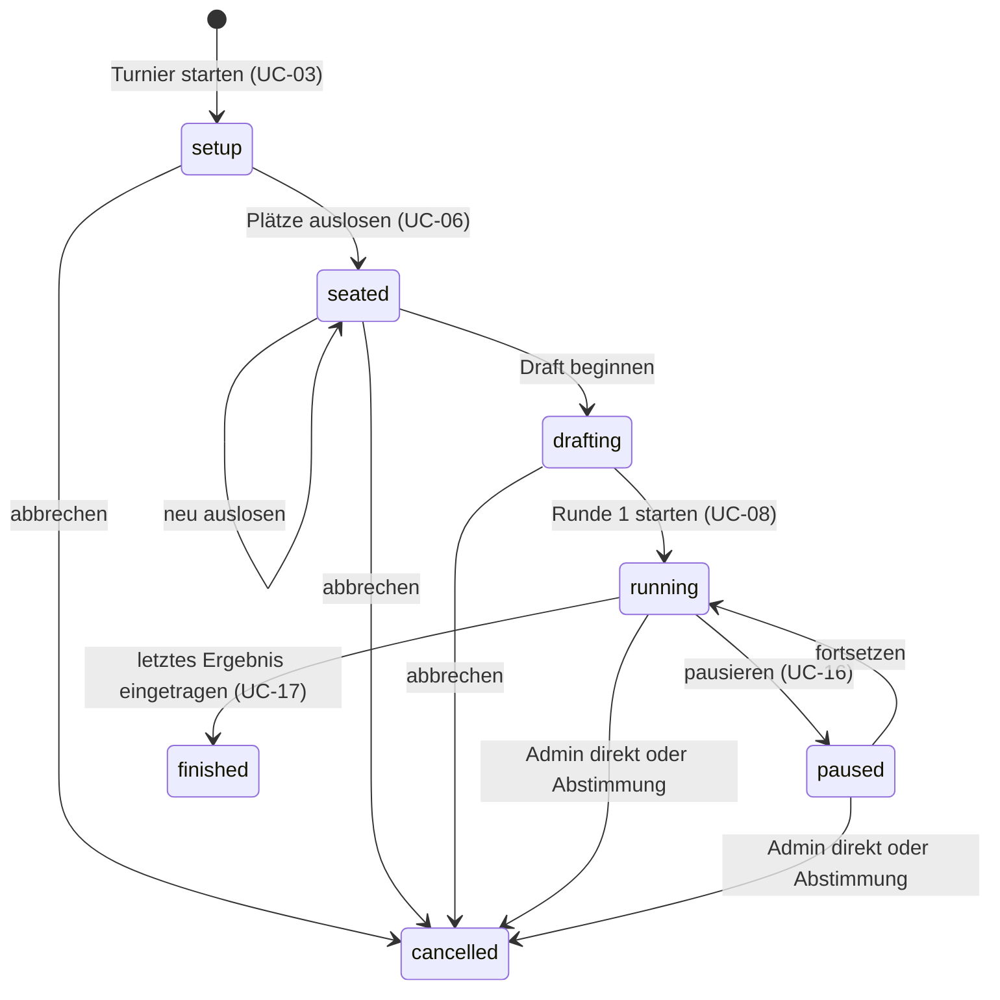

# ADR-0013: Zustände eines Turniers und Berechtigungen

- Status: angenommen (18.11.2026)
- Datum: 2026-11-18

## Kontext
Ein Draft-Turnier durchläuft mehrere Abschnitte: Einladen, Auslosen, Draften, Spielen, eventuell Pausieren, Abschluss. Mehrere Handys ändern gleichzeitig denselben Stand. Das Schema kennt dafür `tournament_status` (`setup`, `seated`, `drafting`, `running`, `paused`, `finished`), aber noch keine Regeln, welche Übergänge erlaubt sind und wer sie auslösen darf.

## Entscheidung

**Zustandsautomat**

| Übergang | Wer darf | Bedingung |
| --- | --- | --- |
| Turnier starten | jedes Mitglied | Set-Kürzel gesetzt, kein anderes offenes Turnier in der Gruppe |
| Einladen, Gäste zulassen, Teilnehmer entfernen | Turnierstarter | Status `setup` |
| Plätze auslosen, neu auslosen | Turnierstarter | mindestens 2 zugesagte Teilnehmer; schließt die Anmeldung |
| Draft beginnen | Turnierstarter | Status `seated` |
| Farben melden | jeder Teilnehmer für sich | Status `seated`, `drafting` oder `running` |
| Runde 1 und jede weitere Runde starten | jeder Teilnehmer | bei offenen Matches nur mit Bestätigung der Warnung (UC-15) |
| Pausieren, fortsetzen | jeder Teilnehmer | – |
| Ergebnis eintragen, korrigieren | die beiden Spieler des Matches, Gruppen-Admin | bis Status `finished`; jede Korrektur landet in `match_correction` |
| Abbrechen vor Runde 1 | Turnierstarter, Gruppen-Admin | Status `setup`, `seated` oder `drafting`; sofort, mit Bestätigung |
| Abbrechen ab Runde 1, direkt | Gruppen-Admin | Status `running` oder `paused`; sofort, mit Bestätigung |
| Abbrechen ab Runde 1, per Abstimmung | Turnierstarter oder Gruppen-Admin beantragt, Teilnehmer bestätigen | Status `running` oder `paused`; abgebrochen, sobald **mehr als die Hälfte** der Teilnehmer bestätigt hat (siehe unten) |

Ein abgebrochenes Turnier zählt nicht für Rangliste und Statistik.

**Abbruch per Abstimmung (ergänzt am 18.11.2026)**
- Ab Runde 1 können Turnierstarter und Gruppen-Admin einen Abbruch beantragen. Alle Teilnehmer bekommen eine Nachricht in der App und per Push.
- Teilnehmer sind alle Einträge in `tournament_entry`, also auch Gäste. Wer den Antrag stellt und selbst teilnimmt, hat damit schon bestätigt.
- Nötig sind mehr als die Hälfte der Teilnehmer: `bestätigt > teilnehmer / 2`, also 3 von 4 oder 5, 4 von 6 oder 7, 5 von 8.
- Ist die Mehrheit erreicht, setzt der Server das Turnier sofort auf `cancelled`. Bestätigungen lassen sich bis dahin zurücknehmen.
- Pro Turnier ist höchstens ein Antrag offen. Er endet, wenn die Mehrheit erreicht ist, wenn der Antragsteller ihn zurückzieht oder wenn das Turnier `finished` erreicht.
- Solange der Antrag offen ist, läuft das Turnier normal weiter; die Live-Ansicht zeigt „Abbruch beantragt: x von y“.
- Der Gruppen-Admin darf immer direkt abbrechen, in jedem Status vor `finished` und ohne Abstimmung.

**Abschluss**
- Sind alle Matches des Spielplans beendet, setzt der Server das Turnier auf `finished`, berechnet die Tabelle und schreibt `final_place` und `ranking_points` in `tournament_entry` fest.
- Ergibt die Tabelle nach allen Tiebreakern noch Gleichstand (`needs_roll`), fordert die App die betroffenen Spieler zum W20-Wurf auf, bevor der Abschluss gilt.
- Nach `finished` sind keine Korrekturen mehr möglich (UC-14: „bis Turnierende“).

**Gleichzeitige Änderungen**
- `match` bekommt eine Spalte `version int NOT NULL DEFAULT 0`. Ergebnis-Änderungen schicken die bekannte Version mit; passt sie nicht, antwortet der Server mit `409 Conflict` und dem aktuellen Stand.
- Zustandswechsel des Turniers laufen in einer Transaktion mit `SELECT … FOR UPDATE` auf der Turnierzeile.

**Umsetzung**
- Die Übergänge liegen als reine Funktion in `server/topstack/domain/tournament.py` (ohne Datenbank, wie die übrige Domänenlogik) und sind vollständig durch Unit-Tests abgedeckt.
- Jeder erfolgreiche Übergang erzeugt eine WebSocket-Nachricht (`tournament.updated`, `round.started`, `seating.drawn` …).

## Alternativen
- **Ein fester Turnierleiter, der alles bestätigt:** einfacher zu prüfen, widerspricht aber den Use Cases, nach denen jeder die nächste Runde starten und Ergebnisse eintragen darf.
- **Letzte Änderung gewinnt, ohne Version:** einfacher, aber stille Überschreibungen bei zwei Handys sind genau der Fehler, den die Gruppe merken würde.

## Folgen
- Migration ergänzt `match.version`, die Spalten `tournament.cancel_requested_by` und `tournament.cancel_requested_at` sowie die Tabelle `tournament_cancel_vote (tournament_id, player_id, created_at)` mit Primärschlüssel auf beiden IDs und Fremdschlüssel auf `tournament_entry`, sodass nur Teilnehmer bestätigen können, dazu den Status `cancelled` in `tournament_status`; der Teilindex `one_open_tournament_per_group` schließt `cancelled` aus. `docs/schema.sql` wird danach aus der Migration aktualisiert.
- Der Status `drafting` ist optional nutzbar: Wer ohne Draft-Timer spielt, kann direkt von `seated` auf Runde 1 gehen; der Server setzt dann `drafting` implizit.
