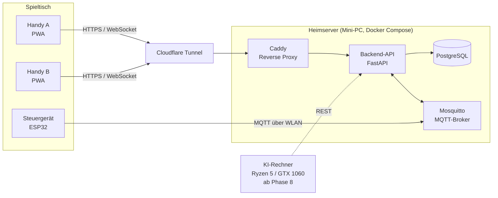
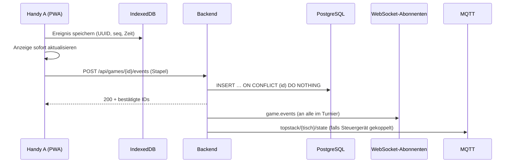

# TopStack – Architektur

Stand: Phase 1 (Architektur & Design), Start 15.11.2026.
Entscheidungen und Begründungen stehen als ADRs in [`docs/adr/`](adr/).

## Überblick

**Grundregeln**

1. **Der Server ist die einzige Wahrheit.** Handys und Steuergerät sprechen nie direkt miteinander. Dadurch braucht das Steuergerät kein Bluetooth (geht in Safari ohnehin nicht).
2. **Offline zuerst im Spiel.** Der Life-Tracker schreibt jedes Ereignis zuerst lokal (IndexedDB) und synchronisiert danach. Fällt Server oder WLAN aus, läuft das Spiel weiter.
3. **Ereignisse statt Endstände.** Lebenspunkte werden als unveränderliche Ereignisse gespeichert. Der Spielstand ist immer die Summe der Ereignisse. Das ermöglicht Rückgängig, Kurven, Awards und später KI.
4. **Mehrgruppenfähig von Anfang an.** v1.0 nutzt eine Gruppe, aber jede Tabelle hängt an `group_id`. v1.1 braucht keinen Umbau.
5. **Domänenlogik ohne Framework.** Spielplan, Tabelle, Tiebreaker und Ranglistenpunkte liegen als reines Python in `server/topstack/domain/` und sind ohne Datenbank testbar.

## Komponenten

| Komponente | Ordner | Technik | Aufgabe |
| --- | --- | --- | --- |
| App | `app/` | React 18, TypeScript, Vite, vite-plugin-pwa, IndexedDB (Dexie) | Life-Tracker, Turnierablauf, Live-Ansicht, Rangliste |
| Backend | `server/` | Python 3.12, FastAPI, SQLAlchemy 2, Alembic, Pydantic | REST-API, WebSocket, Domänenlogik, Push |
| Datenbank | `infra/` | PostgreSQL 16 | Alle dauerhaften Daten |
| Broker | `infra/` | Mosquitto 2 | Ereignisse vom Steuergerät, Live-Daten an das Steuergerät |
| Proxy | `infra/` | Caddy 2 | TLS, statische App-Dateien, `/api` und `/ws` an das Backend |
| Firmware | `firmware/` | PlatformIO, ESP32 (Arduino-Framework), Unity-Tests | Steuergerät ab Phase 6 |
| Doku | `docs/` | Markdown, Mermaid | Architektur, ADRs, Schnittstellen, Datenmodell |

## Datenfluss: ein Lebenspunkt

Doppelte Ereignisse sind harmlos: Die ID wird auf dem Gerät erzeugt, der Server ignoriert bekannte IDs. Deshalb darf die App bei Verbindungsabbruch beliebig oft neu senden.

## Weitere Dokumente

- [Datenmodell](datenmodell.md) und [Schema als SQL](schema.sql)
- [Schnittstellen: REST, WebSocket, MQTT](schnittstellen.md)
- [ADRs](adr/)
