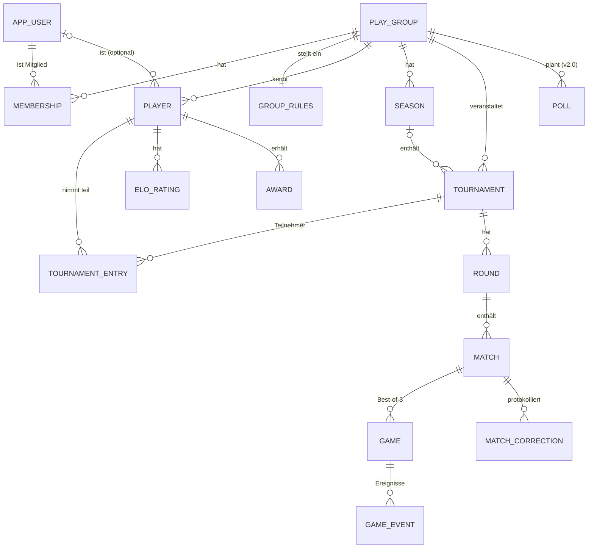

# TopStack – Datenmodell

Vollständiges Schema: [`schema.sql`](schema.sql) (PostgreSQL 16, geprüft). Hintergrund: [ADR-0005](adr/0005-ereignisse-offline-first.md), [ADR-0010](adr/0010-mehrgruppen-datenmodell.md).

## Kernbegriffe

| Begriff | Tabelle | Bedeutung |
| --- | --- | --- |
| Konto | `app_user` | Eine Person mit Anmeldung. Gilt für alle Gruppen. |
| Spieler | `player` | Identität **in einer Gruppe**: Mitglied (mit Konto), Gast oder Ehemaliger (Altdaten). Alle Ergebnisse hängen am Spieler. |
| Gruppe | `play_group` + `group_rules` | Spielgruppe mit eigenen Regeln. Seit v1.1 mehrere (ADR-0018): archivierbar (`archived_at`), 30 Tage im Papierkorb (`deleted_at`), Regeln für die nächste Saison in `pending_rules`, Gruppenbild. |
| Mitgliedschaft | `membership` | Rolle Admin, Mitglied oder Zuschauer. |
| Turnier | `tournament` | Draft-Turnier mit Set. Nur eines pro Gruppe gleichzeitig offen (Teilindex). |
| Teilnahme | `tournament_entry` | Einladung, Draftplatz, Farben, Endplatz, Ranglistenpunkte. |
| Runde | `round` | Feste Runde aus dem Spielplan, optional mit Pause-Spieler. |
| Match | `match` | Best-of-3 zwischen zwei Spielern, Ergebnis als Spiele A : B : Unentschieden. |
| Spiel | `game` | Ein Spiel im Match. ID kommt vom Gerät, damit es offline angelegt werden kann. |
| Ereignis | `game_event` | Unveränderliche Änderung: Lebenspunkte, W20, Rückgängig, Spielende. |

## Änderungen gegenüber dem Entwurf aus Phase 0

- `Ergebnis` aufgeteilt in `tournament_entry` (Platz, Punkte) und `match` (Spiele).
- `Deck` entfernt, stattdessen `colors` (WUBRG) – Archetypen und Decklisten sind bewusst nicht vorgesehen.
- Ereignisart `Gift` und `Commander-Schaden` entfernt (keine Zähler in v1.0). Commander kommt in v2.0 als neue Ereignisart dazu.
- Neu: Gruppe, Mitgliedschaft mit Rolle, Gruppenregeln, Spieleridentität pro Gruppe, Runde, Korrekturprotokoll, Einladung, Passkeys/Sitzungen, Push, Elo, Award, Terminumfrage.

## Abgeleitete Werte

Diese Werte werden **nicht** gespeichert, sondern aus den Daten berechnet (Domänenlogik in `server/topstack/domain/`):

- Lebenspunkte eines Spiels: Startleben + Summe aller `life`-Ereignisse, abzüglich rückgängig gemachter.
- Turniertabelle mit Tiebreakern ([`standings.py`](../server/topstack/domain/standings.py)).
- Ranglistenpunkte: Spielerzahl − Platz + 1 + Bonus ([`ranking.py`](../server/topstack/domain/ranking.py)). Werden beim Turnierabschluss zusätzlich in `tournament_entry.ranking_points` festgeschrieben, damit spätere Regeländerungen alte Turniere nicht verändern.
