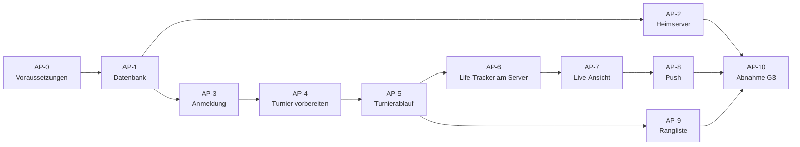

# Phase 3 – Backend, Turniere & Rangliste

Stand: 18.11.2026 · Status: **in Arbeit**, gestartet am 18.11.2026 · Entscheidungen E1 bis E5 getroffen (Abschnitt 6)

Phase 3 macht aus dem Offline-Life-Tracker eine Turnier-App: Der Heimserver speichert Turniere, Ergebnisse und Ereignisse, alle Eingeladenen sehen den Verlauf live, und am Ende steht eine dauerhafte Rangliste.

**Gate G3:** Ein echtes Draft-Turnier ist komplett in TopStack erfasst, und die Rangliste ist für alle sichtbar.

Weitere Unterlagen zu dieser Phase:

| Dokument | Inhalt |
| --- | --- |
| [Testplan](testplan.md) | Testebenen, Testfälle je Use Case, Abnahmeszenario für G3 |
| [Heimserver einrichten](heimserver.md) | Schritt für Schritt vom Mini-PC bis `https://topstack.win` |
| [ADR-0012](../adr/0012-sync-app-server.md) | Synchronisation zwischen App und Server |
| [ADR-0013](../adr/0013-turnier-zustaende.md) | Zustände eines Turniers und wer was darf |
| [ADR-0014](../adr/0014-persistenz-und-tests.md) | Datenbankzugriff, Migrationen, Tests mit echtem PostgreSQL |
| [Schnittstellen](../schnittstellen.md) | REST, WebSocket, MQTT (Ergänzungen für Phase 3 am Ende) |
| [Schema](../schema.sql) | Grundlage für die erste Migration |

---

## 1. Ziele und Umfang

### Im Umfang

| Bereich | Anforderungen | Use Cases |
| --- | --- | --- |
| Anmeldung und Einladung in die Gruppe | N-03 | UC-02 |
| Turnier starten, einladen, Gäste, Auslosung, Farben | F-01 bis F-04, F-06 | UC-03 bis UC-07 |
| Spielplan, Vorziehen, Runden, Pause und Fortsetzen | F-07, F-08, F-14 | UC-08, UC-09, UC-15, UC-16 |
| Match am Server: W20, Life-Tracker mit 1 oder 2 Handys, Zeitlimit | F-09 bis F-12, N-01 | UC-10, UC-11 |
| Ergebnisse eintragen, korrigieren, Unentschieden | F-11, F-13 | UC-12 bis UC-14 |
| Live-Ansicht und Pause-Ansicht | F-15, N-04 | – |
| Turniertabelle mit Tiebreakern, Turnierabschluss | F-16 | UC-17 (ohne Awards) |
| Push-Benachrichtigungen | F-17 | – |
| Rangliste und Basis-Statistik | F-18, F-22 (Basis) | – |

### Bewusst nicht in Phase 3

- Backups, Monitoring, automatisches Deployment, Changelog → **Phase 4**
- **Test auf dem iPhone** → letzter Schritt vor v1.0 (Phase 4), Entscheidung vom 18.11.2026
- **Freunde mit eigenem Konto** → erst zum Release von v1.0 (Phase 4); bis dahin hat nur Peter ein Konto, Entscheidung vom 20.11.2026. Damit sie trotzdem in der Rangliste stehen, legt der Admin sie als vorgemerkte Spieler ohne Konto an (ADR-0015, Umsetzung in AP-4)
- Mehrere Gruppen in der Oberfläche, Zuschauer-Link, Elo, Awards, Head-to-Head als eigene Ansicht, Google-Login → **v1.1**
- Steuergerät, MQTT im Betrieb → **Phase 6**

Das Datenmodell ist trotzdem von Anfang an mehrgruppenfähig (ADR-0010). Phase 3 legt die eigene Gruppe per Skript an.

---

## 2. Was schon da ist

| Baustein | Ort | Stand |
| --- | --- | --- |
| Domänenlogik Spielplan, Tabelle, Tiebreaker, Ranglistenpunkte, Auslosung, Vorschläge, Lebenspunkte | `server/topstack/domain/` | fertig, getestet (Phase 1) |
| Datenbankschema mit 24 Tabellen | `docs/schema.sql` | in der CI gegen PostgreSQL 16 geprüft |
| REST-, WebSocket- und MQTT-Entwurf | `docs/schnittstellen.md` | abgestimmt |
| FastAPI-Gerüst mit Health-Check, Dockerfile, Image in ghcr.io | `server/` | läuft in der CI |
| Docker Compose mit Caddy, PostgreSQL, Mosquitto | `infra/` | vorbereitet; Cloudflare Tunnel lokal ergänzt, noch nicht committet |
| Offline-Life-Tracker mit Ereignisprotokoll, Zeitlimit, Deckfarben | `app/` | fertig (Phase 2) |

**Lücken, die Phase 3 schließen muss**

1. Es gibt noch keine Datenbankanbindung, keine Modelle und keine Migration.
2. Die App wird noch nicht auf den Heimserver ausgeliefert: Das Volume `app-dist` in `infra/docker-compose.yml` bleibt leer. (Gelöst in AP-2: Image `topstack-web`.)
3. Die App kennt nur lokale Spieler-IDs (`p1`, `p2`). Für Turniere braucht sie die Spieler-UUIDs vom Server.
4. Ein Spielende speichert die App ohne Grund. Der Server unterscheidet `life_zero`, `concede`, `time` und `manual` (`game.end_reason`).

---

## 3. Arbeitspakete

Jedes Arbeitspaket (AP) ist ein eigener Branch und ein eigener Pull Request. Die Schätzungen sind Arbeitsstunden.

### AP-0 · Voraussetzungen (ca. 3 h)

- [x] Domain `topstack.win` registriert (bei Cloudflare, 17.11.2026)
- [x] Cloudflare Tunnel `topstack` angelegt, Route `topstack.win` → `http://caddy:80`, `cloudflared` in `infra/docker-compose.yml` (PR #55, 19.11.2026)
- [x] Resend: Domain `topstack.win` verifiziert (Region eu-west-1, DNS per Auto configure, DMARC `p=none`), API-Schlüssel mit „Sending access“ im Passwort-Manager; kommt in AP-3 in die `.env`
- [x] Heimserver: Docker auf Debian 13 installiert, Stack läuft, `https://topstack.win/api/v1/health` antwortet von außen (19.11.2026)
- [x] E-Mail-Versand für Magic-Links festgelegt: Resend (E2)
- [x] ADR-0012 bis ADR-0014 angenommen (18.11.2026)

**Fertig, wenn:** Domain zeigt per Tunnel auf den Heimserver, die Entscheidungen E1 bis E3 sind getroffen. **Erledigt am 19.11.2026.**

### AP-1 · Datenbank und Migrationen (ca. 6 h) · Branch `feat/p3-db`

- [x] SQLAlchemy-2-Modelle für alle 25 Tabellen (async, `asyncpg`): `server/topstack/db/models.py`
- [x] Erste Alembic-Migration `0001`, die das Schema 1:1 erzeugt, inklusive der Ergänzungen aus ADR-0013 (`cancelled`, `match.version`, Abbruch per Abstimmung). Danach ist die Migration die Wahrheit; `schema.sql` bleibt als lesbare Referenz und wird in der CI gegen die migrierte Datenbank verglichen.
- [x] Datenbanksitzung pro Anfrage (`topstack/db/session.py`), Konfiguration über `TOPSTACK_DATABASE_URL`
- [x] Repositories für Konten und Gruppen (`topstack/db/repo/`), Test-Fixtures mit echtem PostgreSQL in der CI (ADR-0014)
- [x] Skript `python -m topstack.scripts.seed_group`: legt die eigene Gruppe mit Regeln, Saison 2027 und dich als Admin an. Liegt im Paket statt unter `server/scripts/`, damit es auch im Docker-Image läuft.

**Fertig, wenn:** `alembic upgrade head` auf leerer Datenbank läuft, die Migration in der CI gegen `schema.sql` verglichen wird und die Repository-Tests grün sind.

### AP-2 · Auslieferung auf dem Heimserver (ca. 4 h) · Branch `feat/p3-deploy`

Früh, damit jeder weitere Schritt unter der echten Adresse auf dem Handy testbar ist.

- [x] App-Build als eigenes Image `topstack-web`: `app/Dockerfile` baut die App mit Node 22 und legt sie in ein Caddy-Image. Das Volume `app-dist` entfällt; jede neue App-Version kommt mit `docker compose pull`.
- [x] API spielt beim Start `alembic upgrade head` ein (`server/docker-entrypoint.sh`); schlägt die Migration fehl, startet die API nicht.
- [x] Caddy liefert die App aus und leitet `/api` und `/ws` weiter; `/assets/*` lange cachen, alles andere (`index.html`, `sw.js`) immer neu prüfen.
- [x] Port 80 nur noch auf `127.0.0.1` gebunden, von außen geht alles über den Tunnel.
- [x] CI: Job `smoke` startet den Stack ohne Tunnel und prüft App, API und Migration; Job `images` baut `topstack-api` und `topstack-web` in jedem PR und pusht sie auf `main` nach ghcr.io.
- [x] Anleitung [heimserver.md](heimserver.md) am 19.11.2026 komplett durchgespielt (AP-0).
- [ ] Auf dem Heimserver aktualisieren, Gruppe mit `seed_group` anlegen, App auf Android installieren.

**Fertig, wenn:** `https://topstack.win` zeigt die App, `https://topstack.win/api/v1/health` antwortet, die App ist auf einem Android-Handy installierbar.

### AP-3 · Anmeldung und Einladung (ca. 8 h) · Branch `feat/p3-auth` · UC-02

- [x] Magic-Link: Token erzeugen, nur Hash speichern, 15 Minuten gültig, einmal nutzbar. Eingelöst per `POST /auth/magic-link/verify` aus der App, nicht per `GET` (Link-Prüfer in Mailprogrammen). Versand über Resend. (PR #58)
- [x] Passkey: Registrierung und Anmeldung mit der Bibliothek `webauthn`, Relying Party = Domain; Challenges serverseitig (Migration 0002). (PR #58)
- [x] Sitzung als Cookie (HttpOnly, Secure, SameSite=Lax), 1 Jahr mit gleitender Verlängerung (ADR-0008). (PR #58)
- [x] Einladungslink in die Gruppe erzeugen und annehmen. (PR #58)
- [x] App: Anmeldeseite (`/anmelden`), Link einlösen mit Angebot „Passkey anlegen“, Einladungsseite (`/einladung/<token>`), Profil (`/profil`) mit Anzeigename, Lieblingsfarben, Passkey, Einladungslink für Admins und Abmelden.
- [x] Auf dem Heimserver `RESEND_API_KEY` in `infra/.env` eintragen, aktualisieren, selbst per Magic-Link und Passkey anmelden (19.11.2026).
- [ ] Ein Freund tritt über einen Einladungslink bei → verschoben auf den Rollout von v1.0 in Phase 4 (Entscheidung vom 20.11.2026).

**Fertig, wenn:** Ein Freund kann über einen Einladungslink Mitglied werden und bleibt angemeldet; ohne Anmeldung liefert jede geschützte Route `401`. **Erledigt am 20.11.2026** mit eigenem Konto; der Beitritt über eine Einladung ist durch Tests abgedeckt (TC-04, Playwright), der Test mit einem echten Freund folgt in Phase 4.

### AP-4 · Turnier vorbereiten (ca. 8 h) · Branch `feat/p3-tournament-setup` · UC-03 bis UC-07

- [x] Turnier starten mit Pflichtfeld Set-Kürzel; nur ein offenes Turnier pro Gruppe. (PR #61)
- [x] Mitglieder einladen (mit Zusage), Gäste per QR-Code oder Link mit Namen, Entfernen vor der Auslosung. (PR #61)
- [x] Vorgemerkte Spieler ohne Konto (ADR-0015, Migration 0003), persönlicher Einladungslink zum Übernehmen. (PR #61)
- [x] Auslosung mit `domain/seating.py`; der Server schickt einen Seed, damit alle Handys dieselbe Animation zeigen; neu auslosen möglich. (PR #61)
- [x] Farben melden mit der Farbauswahl aus Phase 2 (WUBRG, farblos); Starter und Admin melden für Gäste und vorgemerkte Spieler. (PR #61)
- [x] App: Turnier-Startseite (`/turnier`), Turnierseite (`/turnier/<id>`) mit Spielerauswahl, QR-Code (eigener Erzeuger ohne Bibliothek, `src/domain/qr.ts`), Tischgrafik aus Phase 2 mit Serverdaten, Farben, Abbruch; Gästeseite (`/gast/<token>`). Aktualisierung alle 5 Sekunden, live ab AP-7.
- [x] Anpassungen nach dem ersten Test (20.11.2026): Name des Drafts statt Set-Kürzel (2 bis 20 Zeichen), abgebrochene Turniere löschbar, Farbzeilen mit festem Aufbau, kein Flackern beim Speichern, nichts breiter als der Bildschirm, Titel bricht um statt abgeschnitten zu werden. Nach dem zweiten Test: Farben erst nach „Draft beginnen“ (Deckbau); fehlen beim Start von Runde 1 (AP-5) noch Farben, kommt eine Warnung mit den Namen, mit Bestätigung startet die Runde trotzdem.
- [ ] Auf dem Heimserver ein Testturnier mit 5 Spielern inklusive einem Gast anlegen.

**Fertig, wenn:** Ein Turnier mit 5 Spielern inklusive einem Gast ist angelegt, ausgelost und alle Farben sind gemeldet.

### AP-5 · Turnierablauf und Ergebnisse (ca. 10 h) · Branch `feat/p3-rounds` · UC-08, UC-09, UC-12 bis UC-17

- Runde 1 starten erzeugt den Spielplan mit `domain/schedule.py`; Pause bei ungerader Spielerzahl.
- Nächste Runde durch jeden Teilnehmer, bei offenen Matches mit Warnung.
- Offenes Match vorziehen mit `domain/suggestions.py`, Restplan neu verteilen.
- Ergebnis eintragen ohne Tracker, bestätigen, korrigieren bis Turnierende (`match_correction`), Gegner bekommt eine Nachricht.
- Turniertabelle mit `domain/standings.py`; Gleichstand nach allen Tiebreakern fordert einen W20-Wurf an.
- Pausieren und fortsetzen.
- Abbrechen: vor Runde 1 durch Starter oder Admin, ab Runde 1 direkt durch den Admin oder per Abstimmung mit mehr als der Hälfte der Teilnehmer (ADR-0013).
- Turnierabschluss, sobald alle Matches gespielt sind: Endplätze und Ranglistenpunkte festschreiben (`domain/ranking.py`), Siegerehrung.

**Fertig, wenn:** Ein Turnier mit 5 Spielern ist von Runde 1 bis zur Siegerehrung durchspielbar, nur mit eingetragenen Ergebnissen.

### AP-6 · Life-Tracker am Server (ca. 8 h) · Branch `feat/p3-tracker-sync` · UC-10, UC-11, N-01

- Match aus dem Turnier starten; Modus „ein gemeinsames Handy“ oder „jeder sein eigenes“.
- Ereignisse aus der App über eine Outbox an den Server senden (ADR-0012), offline weiterzählen, danach nachsenden.
- Zweites Handy koppeln: Es zählt nur den eigenen Spieler und sieht den Gegner live.
- Spielende mit Grund (`life_zero`, `concede`, `time`) speichern; das Matchergebnis entsteht automatisch (F-11).
- Lokale Matches ohne Turnier aus Phase 2 bleiben möglich und bleiben auf dem Gerät.

**Fertig, wenn:** Zwei Handys zählen dasselbe Match, eines geht kurz offline, danach stimmen Lebenspunkte und Ergebnis auf beiden und auf dem Server.

### AP-7 · Live-Ansicht (ca. 6 h) · Branch `feat/p3-live` · F-15, N-04

- WebSocket `/ws` mit Themen `tournament:<id>` und `game:<id>` (siehe Schnittstellen).
- Nach einem Abbruch Stand per REST nachladen und neu abonnieren.
- App: Live-Ansicht mit laufenden Matches, Pausen, offenen Matches, Tabelle, Lebenspunkten.
- Pause-Ansicht: Lebenspunkte der anderen Matches, Tabelle, eigene Bilanz gegen den nächsten Gegner.

**Fertig, wenn:** Eine Lebenspunkt-Änderung erscheint bei allen Eingeladenen in unter 2 Sekunden.

### AP-8 · Push-Benachrichtigungen (ca. 4 h) · Branch `feat/p3-push` · F-17

- Web Push mit VAPID-Schlüsseln (aus der `.env`, nicht im Repo).
- Ereignisse: Du bist dran, neue Runde, Turnierende, Einladung, Ergebnis korrigiert, Abbruch beantragt.
- Jedes Ereignis einzeln abschaltbar.
- Auf dem iPhone kommt Push nur bei installierter App an; das wird beim iPhone-Test in Phase 4 geprüft.

**Fertig, wenn:** Ein Android-Handy bekommt „Du bist dran“ bei geschlossener App.

### AP-9 · Rangliste und Basis-Statistik (ca. 5 h) · Branch `feat/p3-leaderboard` · F-18, F-22

- Rangliste pro Saison und gesamt: Ranglistenpunkte, Summe und Durchschnitt der Matchpunkte.
- Basis-Statistik: Turniersiege, Platzierungen, Match- und Spiel-Siegquote, meistgespielte Farben.
- Filter nach Saison und Zeitraum.

**Fertig, wenn:** Nach zwei Testturnieren stimmen Rangliste und Statistik mit einer Handrechnung überein.

### AP-10 · Abnahme Gate G3 (ca. 2 h)

- Echtes Draft-Turnier mit der Gruppe, Ablauf nach [Testplan, Abschnitt 4](testplan.md#4-abnahmeszenario-gate-g3).
- Fehler aus dem Turnier als Issues erfassen und vor Phase 4 beheben.
- Roadmap und Doku aktualisieren.

---

## 4. Zeitplan

| Woche | Arbeitspakete | Summe |
| --- | --- | --- |
| 1–2 | AP-0, AP-1, AP-2 | 13 h |
| 3–4 | AP-3, AP-4 | 16 h |
| 5–6 | AP-5 | 10 h |
| 7–8 | AP-6, AP-7 | 14 h |
| 9–10 | AP-8, AP-9, AP-10 | 11 h |
| **gesamt** | | **ca. 64 h** |

Bei 6 Stunden pro Woche sind das gut **10 bis 11 Wochen**, also mehr als die 6–8 Wochen aus der Roadmap. Da Phase 2 schon im November fertig ist, reicht der Puffer trotzdem: Startet Phase 3 im Dezember 2026, ist sie etwa Ende Februar 2027 fertig, also vor dem geplanten Ende im April 2027.

Falls es eng wird, lässt sich AP-8 (Push) nach Phase 4 schieben, ohne dass G3 gefährdet ist.

---

## 5. Definition of Done (für jedes Arbeitspaket)

- [ ] Akzeptanzkriterien des Pakets erfüllt
- [ ] Domänenlogik mit Unit-Tests, API mit Tests gegen echtes PostgreSQL, Abläufe mit Playwright
- [ ] CI grün (Lint, Typecheck, Tests, Build, Schema-Check)
- [ ] `docs/schnittstellen.md` und betroffene ADRs aktuell
- [ ] Pull Request mit Beschreibung: was, warum, wie geprüft
- [ ] Auf dem Heimserver ausgeliefert und auf einem Android-Handy angeklickt (ab AP-2)

---

## 6. Offene Entscheidungen

Alle Entscheidungen wurden am 18.11.2026 getroffen.

| Nr. | Frage | Entscheidung |
| --- | --- | --- |
| E1 | Domain | `topstack.win`, bei Cloudflare registriert (17.11.2026) |
| E2 | E-Mail-Versand für Magic-Links | Resend (kostenlos bis 3.000 Mails im Monat), Absender `login@topstack.win`, Domain per SPF und DKIM bei Cloudflare bestätigt; Anbindung in AP-3 |
| E3 | Betriebssystem des Heimservers | Bestehendes Debian mit Docker auf dem Beelink EQ14 (wie im Repo `heimserver`) bleibt, keine Neuinstallation |
| E4 | Werden lokale Matches aus Phase 2 nachträglich hochgeladen? | Nein, sie bleiben lokal; nur Turnier-Matches gehen an den Server (ADR-0012) |
| E5 | Wer darf ein Turnier abbrechen? | Vor Runde 1 Turnierstarter und Gruppen-Admin. Ab Runde 1 der Gruppen-Admin direkt oder per Abstimmung: Turnierstarter oder Admin beantragt, mehr als die Hälfte der Teilnehmer bestätigt (ADR-0013) |

---

## 7. Risiken

| Risiko | Auswirkung | Gegenmaßnahme |
| --- | --- | --- |
| Passkeys an falsche Domain gebunden | Alle müssen sich neu registrieren | Domain in AP-0 endgültig festlegen, Magic-Link bleibt als Rückfall |
| Synchronisation verliert Ereignisse | Falscher Spielstand | Idempotente Ereignisse, Outbox, Test mit Flugmodus (ADR-0012) |
| Zwei Handys tragen gleichzeitig Ergebnisse ein | Widersprüchliches Ergebnis | Optimistische Sperre über Versionsnummer, Korrekturprotokoll (ADR-0013) |
| WebSocket über Cloudflare bricht ab | Live-Ansicht friert ein | Herzschlag alle 25 s, automatischer Neuaufbau, Nachladen per REST |
| Phase dauert länger als geplant | v1.0 rückt nach hinten | Früher Start im Dezember, AP-8 notfalls verschieben |
| Heimserver nicht erreichbar | Kein Turnier möglich | Life-Tracker läuft offline weiter; Backups und Monitoring in Phase 4 |
