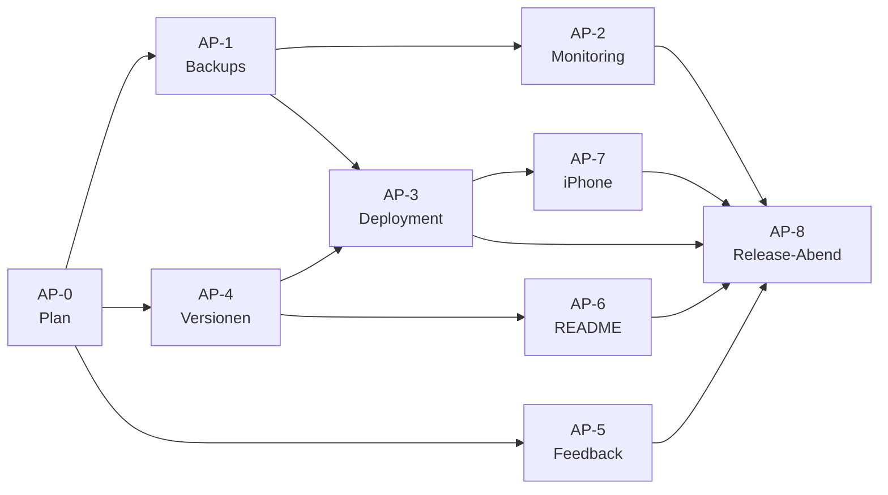

# Phase 4 – Beta mit Freunden & Betrieb (v1.0)

Stand: 21.11.2026 · Status: **gestartet am 21.11.2026** · Entscheidungen E1 bis E4 getroffen (Abschnitt 6)

Phase 4 macht aus der Turnier-App einen Dienst, auf den sich die Gruppe verlassen kann: Die Daten werden jede Nacht gesichert und außer Haus gelagert, ein Ausfall fällt auf, bevor jemand anruft, und eine neue Version kommt ohne SSH auf den Heimserver. Am Ende steht der Release-Abend von v1.0, an dem auch Gate G3 aus Phase 3 abgenommen wird.

**Gate G4:** Version 1.0 ist live, alle Freunde nutzen sie, ein Backup wurde erfolgreich wiederhergestellt. Am selben Abend wird G3 abgenommen (Checkliste AP-10 aus [Phase 3](../phase3/README.md#ap-10--abnahme-gate-g3-ca-2-h--verschoben-zum-release-v10)).

Weitere Unterlagen zu dieser Phase:

| Dokument | Inhalt |
| --- | --- |
| [ADR-0016](../adr/0016-betrieb-backup-monitoring-deployment.md) | Backups, Monitoring und Deployment auf dem Heimserver |
| [Heimserver einrichten](../phase3/heimserver.md) | Grundeinrichtung; bekommt in AP-1 bis AP-3 neue Abschnitte |
| [Testplan Phase 3](../phase3/testplan.md) | Abnahmeszenario G3; neue Testfälle TC-90 bis TC-117 stehen unten |

---

## 1. Ziele und Umfang

### Im Umfang

- Nächtliche Backups mit verschlüsselter Kopie in Cloudflare R2 und regelmäßig geprüfter Wiederherstellung
- Monitoring mit Uptime Kuma und einem Wächter von außen, Alarm als Push über ntfy
- Automatisches Deployment: Der Heimserver holt neue Images selbst, sichert vorher und rollt bei Fehlern zurück
- Semantic Versioning, Changelog und GitHub-Releases
- Feedback-Button in der App, aus dem ein GitHub-Issue wird
- README fürs Portfolio
- iPhone-Test
- Rollout an die ganze Gruppe und Release-Abend v1.0

### Bewusst nicht in Phase 4

- Neue Funktionen für Spieler. Alles, was nicht für den Betrieb oder für Fehler aus der Beta nötig ist, geht ins Backlog für v1.1.
- Hochverfügbarkeit oder ein zweiter Server. Fällt der Mini-PC aus, läuft der Life-Tracker offline weiter (N-01), und die Daten sind über das Backup gesichert.
- Zentrales Log-System (Loki, Grafana). `docker compose logs` reicht für eine Gruppe.

---

## 2. Was schon da ist

| Bereich | Stand |
| --- | --- |
| Heimserver | Beelink EQ14 mit Debian 13 und Docker, Stack aus `infra/docker-compose.yml`, erreichbar unter `https://topstack.win` über den Cloudflare Tunnel |
| Images | CI baut `topstack-api` und `topstack-web` in jedem PR und pusht sie auf `main` mit den Tags `latest` und Commit-SHA nach ghcr.io |
| Updates | Von Hand per SSH: `git pull`, `docker compose pull`, `up -d` ([Heimserver, Abschnitt 7](../phase3/heimserver.md#7-aktualisieren)); die API spielt Migrationen beim Start ein |
| Anzeige | Startbildschirm zeigt „Update #<PR>“ und den Stand des Servers, `/api/v1/health` liefert Version und Build |
| Backup | Nur von Hand mit `pg_dump` vor dem Spieleabend ([Heimserver, „Vor dem Spieleabend“](../phase3/heimserver.md#vor-dem-spieleabend-datenbank-sichern)) |
| Version | `0.1.0` in `app/package.json` und `server/pyproject.toml`, keine Tags, kein Changelog |
| Feedback | Issue-Vorlage „Spieleabend“ (`.github/ISSUE_TEMPLATE/spieleabend.yml`), nur mit GitHub-Konto nutzbar |

---

## 3. Arbeitspakete

Jedes Arbeitspaket ist ein eigener Branch und ein eigener Pull Request. Die Schätzungen sind Arbeitsstunden.

AP-1 kommt zuerst, weil das automatische Deployment (AP-3) vor jeder Migration ein Backup braucht und das Monitoring (AP-2) das Backup überwacht.

### AP-0 · Plan und Entscheidungen (ca. 1 h) · Branch `docs/phase4-plan`

- [x] Plan `docs/phase4/README.md`
- [x] Entscheidungen E1 bis E4 getroffen (21.11.2026)
- [x] ADR-0016 Backups, Monitoring und Deployment angenommen
- [x] Roadmap aktualisiert (21.11.2026)

**Fertig, wenn:** Der Plan ist gemergt.

### AP-1 · Backups (ca. 4 h) · Branch `feat/p4-backup` · N-03

Grundsatz: Ein Backup gilt erst als vorhanden, wenn es sich wiederherstellen ließ.

- [ ] Image `infra/backup/Dockerfile` auf Basis von `postgres:16` mit `age` und `rclone`; Dienst `backup` in `infra/docker-compose.yml` mit `profiles: [ops]`, damit er nur auf Abruf läuft
- [ ] Skript `infra/backup/backup.sh`: `pg_dump -Fc`, Prüfung mit `pg_restore --list`, Ablage unter `~/topstack-backups/` (unverschlüsselt, die Daten liegen auf dem Server ohnehin), für R2 verschlüsselt mit `age` an einen öffentlichen Schlüssel und hochgeladen
- [ ] Aufbewahrung: 7 tägliche, 4 wöchentliche (Sonntag), 6 monatliche (1. des Monats) lokal und in R2; in R2 zusätzlich eine Lifecycle-Regel als Netz
- [ ] Bucket `topstack-backups` in R2 mit Speicherort EU, API-Token nur mit „Object Read & Write“ auf diesen Bucket
- [ ] Der **private** `age`-Schlüssel liegt nur im Passwort-Manager, nie auf dem Heimserver: Wer den Server übernimmt, kann die Kopien in R2 nicht lesen
- [ ] systemd-Timer `topstack-backup.timer` auf dem Heimserver, täglich um 03:30, ruft `docker compose --profile ops run --rm backup` auf
- [ ] Skript `infra/backup/restore-test.sh`: neuestes Backup aus R2 holen, in einem Wegwerf-PostgreSQL wiederherstellen, prüfen (Alembic-Version gleich `head`, Anzahl Spieler, Turniere und Ereignisse größer 0 und gleich der Live-Datenbank zum Zeitpunkt des Backups), Ergebnis melden
- [ ] Timer `topstack-restore-test.timer`, monatlich am 1. um 04:30
- [ ] `infra/backup/restore.sh` für den Ernstfall, ersetzt den Abschnitt „Nur im Notfall zurückspielen“ in `heimserver.md`
- [ ] Wiederherstellung einmal echt geprobt auf dem Windows-PC mit Docker Desktop (Entscheidung vom 21.11.2026, der Ryzen-PC ist vorerst nicht in Betrieb): Repo frisch von GitHub klonen, neuestes Backup aus R2 laden, mit dem privaten Schlüssel aus dem Passwort-Manager entschlüsseln, Stack **ohne** Cloudflare Tunnel starten, einspielen, unter `http://localhost` Turniere und Rangliste prüfen; danach Stack und Daten wieder löschen. Backup und Klon liegen dabei **nicht** im OneDrive-Ordner, damit keine Spielerdaten in die Cloud synchronisiert werden. Nichts vom Mini-PC darf dafür nötig sein
- [ ] Anleitung dazu in `heimserver.md`, Abschnitt „Ernstfall: auf einem anderen Rechner wiederherstellen“. Ausweichlösung, falls Docker Desktop nicht geht: auf dem Heimserver in einem frischen Klon mit eigenem Compose-Projekt, ohne die bestehende `.env` und ohne `~/topstack-backups`

**Fertig, wenn:** Ein nächtliches Backup liegt in R2, der Wiederherstellungstest läuft grün, und die Probe auf dem Windows-PC hat geklappt (Teil von G4).

### AP-2 · Monitoring (ca. 3 h) · Branch `feat/p4-monitoring`

Ein Monitoring auf demselben Rechner kann nicht melden, dass dieser Rechner aus ist. Deshalb zwei Ebenen.

- [ ] `/api/v1/health` prüft zusätzlich die Datenbank (`SELECT 1`, Antwort 503, wenn sie fehlt) und meldet die Alembic-Version
- [ ] Uptime Kuma als Dienst `uptime-kuma` in `infra/docker-compose.yml`, nur auf `127.0.0.1:3001`; Zugriff per SSH-Tunnel vom PC
- [ ] Überwachung in Uptime Kuma: `https://topstack.win` (App), `https://topstack.win/api/v1/health` (API und Datenbank, Schlüsselwort `"status":"ok"`), MQTT-Port im Heimnetz, Ablauf des TLS-Zertifikats
- [ ] Wächter von außen: kostenloses Konto bei healthchecks.io. Uptime Kuma meldet sich alle 5 Minuten dort; bleibt das Signal 15 Minuten aus (Strom, Netz, Mini-PC), schlägt healthchecks.io Alarm
- [ ] Backup und Wiederherstellungstest melden Erfolg und Fehler an je einen eigenen Check bei healthchecks.io; fehlt das nächtliche Backup, kommt bis 06:00 ein Alarm
- [ ] Alarm als Push über ntfy (E3): App auf dem Handy, Thema mit zufälligem Namen; die Nachrichten enthalten keine Spielerdaten
- [ ] Probealarm: Stack stoppen, Netzwerkkabel ziehen, Backup absichtlich scheitern lassen

**Fertig, wenn:** Alle drei Probealarme kommen innerhalb von 15 Minuten als Push an.

### AP-3 · Automatisches Deployment (ca. 4 h) · Branch `feat/p4-deploy`

Der Heimserver holt neue Versionen selbst (E2). Es gibt keinen Zugang von außen und keinen Runner mit Rechten auf dem Server.

- [ ] CI-Tags: auf `main` wie bisher Commit-SHA plus neu `main`; bei einem Git-Tag `v*` zusätzlich `1.0.0`, `1.0` und `latest`. `latest` heißt damit „letzte Release-Version“
- [ ] Kanal in der `.env` des Heimservers: `TOPSTACK_VERSION=main` während der Beta, ab v1.0 `latest`
- [ ] Skript `infra/ops/deploy.sh`: Repo aktualisieren (Kanal `main`: `git pull --ff-only`; Kanal `latest`: neuesten Tag auschecken), `docker compose pull`, Digests vergleichen; nur wenn sich etwas geändert hat:
  1. Backup wie in AP-1 (Grund `pre-deploy`)
  2. bisherige Digests nach `~/topstack-state/last-good.env` schreiben
  3. `docker compose up -d`
  4. bis zu 2 Minuten auf `/api/v1/health` mit der neuen Version warten
  5. bei Erfolg Push über ntfy mit der neuen Update-Nummer, bei Fehler Rollback auf `last-good.env` und Alarm
- [ ] Migrationen, die sich nicht zurückrollen lassen: Rollback stellt dann zusätzlich das `pre-deploy`-Backup wieder her (nur nach Bestätigung, Skript bricht sonst mit Anleitung ab)
- [ ] Deploy-Sperre: Liegt `~/topstack-state/deploy.lock`, wird nichts ausgerollt. Gedacht für Spieleabende, damit kein Update mitten im Turnier kommt
- [ ] systemd-Timer `topstack-deploy.timer` alle 5 Minuten
- [ ] `heimserver.md`, Abschnitt 7 „Aktualisieren“ neu: automatisch, Sperre, Rollback von Hand

**Fertig, wenn:** Ein Merge in `main` steht nach spätestens 15 Minuten ohne SSH auf dem Startbildschirm, und ein absichtlich kaputtes Image wird automatisch zurückgerollt.

### AP-4 · Versionen und Changelog (ca. 2 h) · Branch `chore/p4-versioning`

- [ ] Semantic Versioning für App und API gemeinsam: eine Version für das ganze Repo, Git-Tag `vMAJOR.MINOR.PATCH`
- [ ] Bis zum Release `0.9.x` als Beta, der Release-Abend bekommt `v1.0.0`
- [ ] `CHANGELOG.md` nach „Keep a Changelog“, auf Deutsch, Abschnitt „Unveröffentlicht“ wird in jedem PR ergänzt; Hinweis im PR-Template
- [ ] Skript `scripts/release.sh 1.0.0`: Version in `app/package.json` und `server/pyproject.toml` setzen, Changelog-Abschnitt umbenennen, Commit und Tag anlegen
- [ ] Workflow `release.yml`: bei Tag `v*` GitHub-Release mit dem passenden Changelog-Abschnitt
- [ ] Startbildschirm zeigt die Version vor der Update-Nummer, zum Beispiel „v1.0.0 · Update #140“

**Fertig, wenn:** Ein Tag `v0.9.0` erzeugt ein GitHub-Release, Images mit der Versionsnummer und die Anzeige in der App.

### AP-5 · Feedback aus der App (ca. 2 h) · Branch `feat/p4-feedback`

Die Freunde brauchen kein GitHub-Konto (E4).

- [ ] Menüpunkt „Feedback“: Art (Fehler, Wunsch, Sonstiges), Text, optional „Was hast du gerade gemacht?“; App-Version, Update-Nummer, Gerät und Browser werden automatisch angehängt
- [ ] Hinweis im Formular: Das Repo ist öffentlich, das Feedback erscheint dort mit deinem Anzeigenamen; keine E-Mail-Adressen oder anderen persönlichen Daten
- [ ] `POST /api/v1/feedback`, nur für angemeldete Nutzer, höchstens 10 pro Tag und Nutzer; neue Tabelle `feedback` mit Migration, damit nichts verloren geht, wenn GitHub nicht antwortet
- [ ] Der Server legt daraus ein Issue mit den Labels `feedback` und `bug` oder `wunsch` an; Token: Fine-grained PAT nur für `krauspeter/topstack`, nur „Issues: Read and write“, in der `.env`
- [ ] Nicht übertragene Einträge werden beim nächsten Start nachgeschickt
- [ ] Ablauf alle zwei Wochen: offene `feedback`-Issues sichten, Labels und Meilenstein setzen, Fehler für die nächste Version einplanen

**Fertig, wenn:** Feedback vom Handy erscheint als Issue, auch wenn GitHub beim Absenden kurz nicht erreichbar war.

### AP-6 · README fürs Portfolio (ca. 2 h) · Branch `docs/p4-readme`

- [ ] Einleitung in zwei Sätzen, Screenshots (Life-Tracker, Tischgrafik, Live-Ansicht, Rangliste) aus Playwright erzeugt, damit sie aktuell bleiben
- [ ] Architekturbild als Mermaid aus `docs/architektur.md`
- [ ] Abschnitte: Funktionen, Tech-Stack, Architekturentscheidungen (Liste der ADRs), Tests und CI, Betrieb, Roadmap
- [ ] Badges: CI, Lizenz, neueste Version
- [ ] Englische Fassung `README.en.md`, da das Portfolio auch für englischsprachige Bewerbungen gedacht ist

**Fertig, wenn:** Das README zeigt auf GitHub alle Screenshots und das Architekturbild.

### AP-7 · iPhone-Test (ca. 2 h) · Entscheidung vom 18.11.2026

Letzter Schritt vor v1.0. Dafür braucht es ein geliehenes iPhone mit aktuellem iOS.

- [ ] Testfälle TC-110 bis TC-117 (Abschnitt 4) auf dem iPhone durchgespielt
- [ ] Gefundene Fehler behoben oder als bekannte Einschränkung im README und im Changelog vermerkt

**Fertig, wenn:** Alle Testfälle mit Priorität hoch sind auf dem iPhone bestanden.

### AP-8 · Rollout und Release-Abend v1.0 (ca. 3 h)

**Vorher**

- [ ] AP-1 bis AP-7 abgeschlossen, Changelog für v1.0.0 fertig
- [ ] Alle Mitspieler ohne Konto bekommen ihren persönlichen Einladungslink (vorgemerkte Spieler übernehmen dabei ihre Ergebnisse, ADR-0015)
- [ ] Kurze Anleitung für die Gruppe: installieren, anmelden, Push erlauben, Feedback geben
- [ ] Release `v1.0.0` getaggt, Heimserver auf Kanal `latest`
- [ ] Am Tag des Spieleabends: Deploy-Sperre setzen, Backup von Hand anstoßen

**Am Abend**

- [ ] Abnahme G3 nach der Checkliste AP-10 aus Phase 3
- [ ] Push im echten Turnier: „Du bist dran“, neue Runde, Turnierende kommen an (Entscheidung vom 21.11.2026)

**Danach**

- [ ] Deploy-Sperre aufheben
- [ ] Wiederherstellung des Backups vom Abend auf dem Windows-PC, Rangliste stimmt überein
- [ ] Feedback des Abends gesichtet, Fehler für v1.0.1 eingeplant
- [ ] Roadmap aktualisiert, Phase 4 abgeschlossen

**Fertig, wenn:** G3 und G4 sind abgenommen.

### Eingeschoben

Kleine Wünsche aus der Beta, die nicht bis v1.1 warten müssen:

- [ ] Profil zeigt je Gruppe, wer dazugehört: Mitglieder und vorgemerkte Spieler ohne Konto, Gäste nicht (Branch `feat/profil-mitglieder`, 21.11.2026)

---

## 4. Testfälle

| ID | Fall | Erwartung | AP | Prio |
| --- | --- | --- | --- | --- |
| TC-90 | Nächtliches Backup | Datei lokal und in R2, `pg_restore --list` fehlerfrei, Erfolg bei healthchecks.io | AP-1 | hoch |
| TC-91 | Backup ohne R2 | Lokale Datei bleibt, Alarm über ntfy | AP-1 | hoch |
| TC-92 | Aufbewahrung | Nach simulierten 40 Tagen liegen 7 tägliche, 4 wöchentliche, bis zu 6 monatliche Backups | AP-1 | mittel |
| TC-93 | Wiederherstellungstest | Wegwerf-Datenbank aus R2, Zahlen stimmen, Erfolg gemeldet | AP-1 | hoch |
| TC-94 | Wiederherstellung auf dem Windows-PC | Nur mit Repo, R2 und Schlüssel: App läuft unter `http://localhost` mit allen Turnieren und der Rangliste | AP-1 | hoch |
| TC-95 | Backup ohne privaten Schlüssel | Datei in R2 lässt sich ohne Schlüssel aus dem Passwort-Manager nicht öffnen | AP-1 | mittel |
| TC-100 | Health mit Datenbank | Datenbank gestoppt → `/api/v1/health` antwortet 503 | AP-2 | hoch |
| TC-101 | Stack gestoppt | Push über ntfy innerhalb von 5 Minuten | AP-2 | hoch |
| TC-102 | Mini-PC vom Netz | Push von healthchecks.io innerhalb von 15 Minuten | AP-2 | hoch |
| TC-103 | Backup fehlt | Push bis 06:00 | AP-2 | hoch |
| TC-104 | Merge in `main` | Neue Update-Nummer nach spätestens 15 Minuten, Push „Update #… eingespielt“ | AP-3 | hoch |
| TC-105 | Kaputtes Image | Health schlägt fehl, Rollback auf den letzten guten Stand, Alarm | AP-3 | hoch |
| TC-106 | Deploy-Sperre | Mit `deploy.lock` wird nichts ausgerollt, ohne Sperre beim nächsten Lauf | AP-3 | hoch |
| TC-107 | Release-Tag | Tag `v0.9.0` → Release auf GitHub, Images `0.9.0`, `0.9`, `latest`, Anzeige in der App | AP-4 | hoch |
| TC-108 | Feedback | Formular → Issue mit Labels, ohne E-Mail-Adresse | AP-5 | hoch |
| TC-109 | Feedback ohne GitHub | Eintrag bleibt in der Datenbank, wird später nachgeschickt | AP-5 | mittel |
| TC-110 | iPhone: installieren | Safari → „Zum Home-Bildschirm“, App startet im Vollbild mit Icon | AP-7 | hoch |
| TC-111 | iPhone: Anmeldung | Magic-Link und Passkey über den iCloud-Schlüsselbund | AP-7 | hoch |
| TC-112 | iPhone: Bildschirm bleibt an | 10 Minuten ohne Tippen im Life-Tracker, Bildschirm bleibt an | AP-7 | hoch |
| TC-113 | iPhone: offline | Flugmodus im Match, weiterzählen, danach Abgleich ohne Verlust | AP-7 | hoch |
| TC-114 | iPhone: Push | Push erlauben (nur in der installierten App möglich), „Test senden“ kommt an | AP-7 | hoch |
| TC-115 | iPhone und Android | Ein Match mit je einem Handy, Lebenspunkte in unter 2 s auf beiden | AP-7 | hoch |
| TC-116 | iPhone: Update | Neues Update erscheint nach Neustart der App, Startbildschirm zeigt die Nummer | AP-7 | mittel |
| TC-117 | iPhone: Darstellung | Notch und Home-Leiste verdecken keine Tasten, gedrehte Hälfte richtig | AP-7 | mittel |

---

## 5. Zeitplan

| Woche | Arbeitspakete | Summe |
| --- | --- | --- |
| 1 | AP-0, AP-1 | 5 h |
| 2 | AP-2, AP-4 | 5 h |
| 3 | AP-3, AP-5 | 6 h |
| 4 | AP-6, AP-7, AP-8 | 7 h |
| **gesamt** | | **ca. 23 h** |

Bei 6 Stunden pro Woche passt das in die geplanten 4 Wochen. Der Termin des Release-Abends hängt an der Gruppe und an einem geliehenen iPhone für AP-7.

---

## 6. Entscheidungen

Alle Entscheidungen wurden am 21.11.2026 getroffen und in [ADR-0016](../adr/0016-betrieb-backup-monitoring-deployment.md) festgehalten.

| Nr. | Frage | Entscheidung |
| --- | --- | --- |
| E1 | Wohin geht die Kopie des Backups außer Haus? | Cloudflare R2 (10 GB kostenlos, Konto besteht schon), Bucket mit Speicherort EU, verschlüsselt mit `age`, Upload mit `rclone` |
| E2 | Wie kommt eine neue Version auf den Heimserver? | Der Heimserver holt sie selbst per systemd-Timer aus ghcr.io, sichert vorher und rollt bei Fehlern zurück; kein Watchtower, kein Self-hosted Runner |
| E3 | Wie kommen Alarme an? | Push über ntfy, Wächter von außen über healthchecks.io |
| E4 | Wie melden die Freunde Fehler und Wünsche? | Button in der App, der Server legt daraus ein GitHub-Issue an |

---

## 7. Definition of Done (für jedes Arbeitspaket)

- [ ] Akzeptanzkriterien des Pakets erfüllt, Testfälle aus Abschnitt 4 bestanden
- [ ] Skripte mit `shellcheck` geprüft, Server-Änderungen mit Tests gegen echtes PostgreSQL
- [ ] CI grün
- [ ] `heimserver.md` beschreibt jeden neuen Schritt auf dem Heimserver
- [ ] Keine Geheimnisse im Repo; neue Werte stehen nur als Platzhalter in `infra/.env.example`
- [ ] Pull Request mit Beschreibung und der Update-Nummer, die danach in der App steht
- [ ] Eintrag im Changelog (ab AP-4)

---

## 8. Risiken

| Risiko | Auswirkung | Gegenmaßnahme |
| --- | --- | --- |
| Backup läuft, lässt sich aber nicht wiederherstellen | Daten im Ernstfall weg | Monatlicher automatischer Wiederherstellungstest, einmal echte Probe auf dem Windows-PC |
| Privater `age`-Schlüssel geht verloren | Backups in R2 unbrauchbar | Schlüssel im Passwort-Manager plus Ausdruck an einem sicheren Ort; lokale Backups bleiben unverschlüsselt auf dem Server |
| R2-Token gelangt nach außen | Backups könnten gelöscht werden | Token nur für einen Bucket, lokale Kopien bleiben, Token im Passwort-Manager und nur in der `.env` |
| Update kommt mitten im Turnier | Abbruch der Verbindung, Ärger am Tisch | Deploy-Sperre am Spieleabend; Outbox der App fängt kurze Ausfälle ab (ADR-0012) |
| Automatischer Rollback trifft eine Migration | Datenbank passt nicht zum alten Image | Backup vor jedem Deployment, Rollback der Daten nur nach Bestätigung |
| Kein iPhone verfügbar | AP-7 und damit v1.0 verzögern sich | Früh einen Freund mit iPhone fragen; notfalls v1.0 mit bekannter Einschränkung und iPhone-Test in v1.0.1 |
| Feedback im öffentlichen Repo enthält persönliche Daten | Datenschutz | Hinweis im Formular, nur Anzeigename, keine E-Mail-Adressen; Issue lässt sich bei Bedarf löschen |
