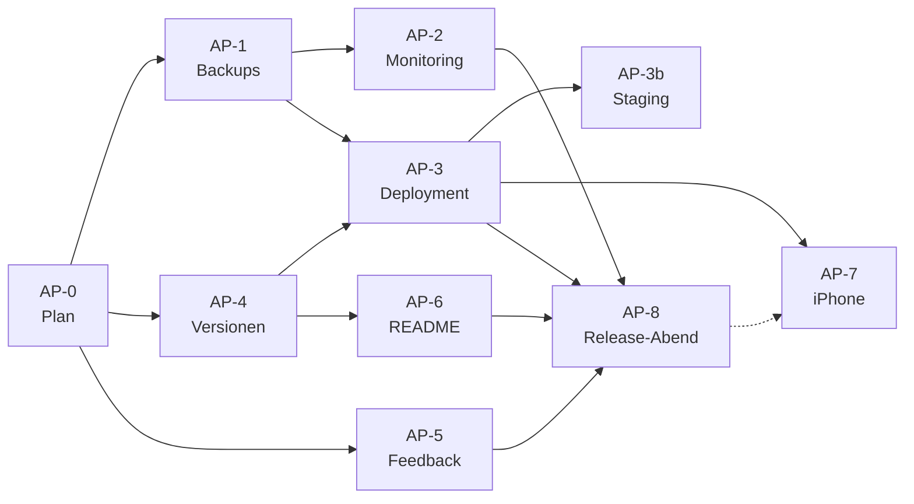

# Phase 4 – Beta mit Freunden & Betrieb (v1.0)

Stand: 27.11.2026 · Status: **abgeschlossen am 27.11.2026** (gestartet am 21.11.2026), v1.0.0 und v1.0.1 veröffentlicht · Entscheidungen E1 bis E4 getroffen (Abschnitt 6)

Phase 4 macht aus der Turnier-App einen Dienst, auf den sich die Gruppe verlassen kann: Die Daten werden jede Nacht gesichert und außer Haus gelagert, ein Ausfall fällt auf, bevor jemand anruft, und eine neue Version kommt ohne SSH auf den Heimserver. Am Ende steht der Release-Abend von v1.0, an dem auch Gate G3 aus Phase 3 abgenommen wird.

**Gate G4:** Version 1.0 ist live, alle Freunde nutzen sie, ein Backup wurde erfolgreich wiederhergestellt. **Erreicht am 27.11.2026:** v1.0.0 seit 25.11. und v1.0.1 seit 25.11. in der Produktion (Kanal `latest`), alle Mitspieler der „Draft-Runde“ haben ein Konto, die Wiederherstellung eines Produktions-Backups auf dem Windows-PC ist am 22.11.2026 gelungen (TC-94).

> **Entscheidung vom 27.11.2026:** Phase 4 wird ohne Gate G3 abgeschlossen. G3 (erstes echtes Turnier, Rangliste sichtbar) entfällt als Gate; der Draftabend am 27.12.2026 ist ein normaler Spieleabend mit v1.0. Was dort auffällt, kommt über den Feedback-Knopf und als Fehlerbehebung (1.0.x). Offen bleiben ohne Gate: iPhone-Test (AP-7), Push im echten Turnier, Wiederherstellung des Backups vom Abend (Abschnitt „Nach Phase 4“ unten).

Weitere Unterlagen zu dieser Phase:

| Dokument | Inhalt |
| --- | --- |
| [ADR-0016](../adr/0016-betrieb-backup-monitoring-deployment.md) | Backups, Monitoring und Deployment auf dem Heimserver |
| [ADR-0017](../adr/0017-staging.md) | Staging-Umgebung `beta.topstack.win` |
| [Heimserver einrichten](../phase3/heimserver.md) | Grundeinrichtung; bekommt in AP-1 bis AP-3 neue Abschnitte |
| [Testplan Phase 3](../phase3/testplan.md) | Abnahmeszenario G3; neue Testfälle TC-90 bis TC-121 stehen unten |

---

## 1. Ziele und Umfang

### Im Umfang

- Nächtliche Backups mit verschlüsselter Kopie in Cloudflare R2 und regelmäßig geprüfter Wiederherstellung
- Monitoring mit Uptime Kuma und einem Wächter von außen, Alarm als Push über ntfy
- Automatisches Deployment: Der Heimserver holt neue Images selbst, sichert vorher und rollt bei Fehlern zurück
- Staging `beta.topstack.win`: zweite Umgebung für jeden neuen Stand und für Pull Requests vor dem Merge
- Semantic Versioning, Changelog und GitHub-Releases
- Feedback-Button in der App, aus dem ein GitHub-Issue wird
- README fürs Portfolio
- iPhone-Test
- Rollout an die ganze Gruppe und Release-Abend v1.0

### Bewusst nicht in Phase 4

- Neue Funktionen für Spieler. Alles, was nicht für den Betrieb oder für Fehler aus der Beta nötig ist, geht ins Backlog für v1.1.
- Hochverfügbarkeit oder ein zweiter Server. Fällt der Mini-PC aus, läuft der Life-Tracker offline weiter (N-01), und die Daten sind über das Backup gesichert.
- Zentrales Log-System (Loki, Grafana). `docker compose logs` reicht für eine Gruppe.

---

## 2. Was schon da ist

| Bereich | Stand |
| --- | --- |
| Heimserver | Beelink EQ14 mit Debian 13 und Docker, Stack aus `infra/docker-compose.yml`, erreichbar unter `https://topstack.win` über den Cloudflare Tunnel |
| Images | CI baut `topstack-api` und `topstack-web` in jedem PR und pusht sie auf `main` mit den Tags `latest` und Commit-SHA nach ghcr.io |
| Updates | Von Hand per SSH: `git pull`, `docker compose pull`, `up -d` ([Heimserver, Abschnitt 7](../phase3/heimserver.md#7-aktualisieren)); die API spielt Migrationen beim Start ein |
| Anzeige | Startbildschirm zeigt „Update #<PR>“ und den Stand des Servers, `/api/v1/health` liefert Version und Build |
| Backup | Nur von Hand mit `pg_dump` vor dem Spieleabend ([Heimserver, „Vor dem Spieleabend“](../phase3/heimserver.md#vor-dem-spieleabend-datenbank-sichern)) |
| Version | `0.1.0` in `app/package.json` und `server/pyproject.toml`, keine Tags, kein Changelog |
| Feedback | Issue-Vorlage „Spieleabend“ (`.github/ISSUE_TEMPLATE/spieleabend.yml`), nur mit GitHub-Konto nutzbar |

---

## 3. Arbeitspakete

Jedes Arbeitspaket ist ein eigener Branch und ein eigener Pull Request. Die Schätzungen sind Arbeitsstunden.



AP-1 kommt zuerst, weil das automatische Deployment (AP-3) vor jeder Migration ein Backup braucht und das Monitoring (AP-2) das Backup überwacht.

### AP-0 · Plan und Entscheidungen (ca. 1 h) · Branch `docs/phase4-plan`

- [x] Plan `docs/phase4/README.md`
- [x] Entscheidungen E1 bis E4 getroffen (21.11.2026)
- [x] ADR-0016 Backups, Monitoring und Deployment angenommen
- [x] Roadmap aktualisiert (21.11.2026)

**Fertig, wenn:** Der Plan ist gemergt.

### AP-1 · Backups (ca. 4 h) · Branch `feat/p4-backup` · N-03

Grundsatz: Ein Backup gilt erst als vorhanden, wenn es sich wiederherstellen ließ.

**Umsetzung im Repo**

- [x] Image `topstack-backup` aus `infra/backup/Dockerfile` (Basis `postgres:16` mit `age`, `rclone`, `curl`), gebaut und nach ghcr.io gepusht wie API und App; Dienst `backup` in `infra/docker-compose.yml` mit `profiles: [ops]`, läuft nur auf Abruf
- [x] Skript `infra/backup/topstack-backup.sh` mit `backup`, `restore-test`, `restore` und `list`:
  - `pg_dump -Fc`, Prüfung mit `pg_restore --list`, Manifest (`.json`) mit Zeitpunkt, Alembic-Version, Prüfsummen und Zeilenzahl von `app_user`, `player`, `tournament`, `match`, `game_event`
  - lokal unter `BACKUP_DIR` unverschlüsselt mit Rechten 600 (die Daten liegen auf dem Server ohnehin), für R2 mit `age` an den öffentlichen Schlüssel verschlüsselt
  - Aufbewahrung lokal und in R2: `daily/` 7, `weekly/` 4 (sonntags), `monthly/` 6 (am 1.), `manual/` 10 (von Hand und vor Deployments)
  - Schlägt der Upload fehl, bleibt das lokale Backup, das Skript endet mit Fehler und meldet ihn an healthchecks.io (ab AP-2)
- [x] Wiederherstellungstest: neuestes lokales Backup in einer Wegwerf-PostgreSQL **im Container** einspielen, Prüfsumme, Alembic-Version und Zeilenzahlen gegen das Manifest prüfen; dazu die Kopie in R2 laden und ihre Prüfsumme vergleichen. Entschlüsseln geht nur mit dem privaten Schlüssel, der nicht auf dem Server liegt; das prüft die Probe auf dem Windows-PC
- [x] `infra/ops/backup.sh` (Aufruf auf dem Heimserver), `infra/ops/restore.sh` für den Ernstfall (fragt nach, sichert vorher, stoppt die API), `infra/ops/install-timers.sh` mit den systemd-Timern `topstack-backup.timer` (täglich 03:30) und `topstack-restore-test.timer` (am 1. um 04:30)
- [x] CI: `shellcheck` für alle Skripte; im Job `smoke` echtes Backup und Wiederherstellungstest gegen den gestarteten Stack (ohne R2)
- [x] Lokal geprüft gegen PostgreSQL 16 mit dem Schema aus `docs/schema.sql`: Backup, Aufbewahrung nach 9 Läufen (7 täglich, 4 wöchentlich), Upload und Aufräumen in R2 (mit Test-Ersatz für `rclone`), Entschlüsseln mit `age`, Wiederherstellungstest bestanden; manipulierte Dateien und fehlgeschlagener Upload werden erkannt
- [x] Anleitung in `docs/phase3/heimserver.md`: „Backups einrichten“ und „Ernstfall: auf einem anderen Rechner wiederherstellen“ (Windows-PC)

**Einrichten (Peter)**

- [x] Cloudflare R2 freigeschaltet, Bucket `topstack-backups` mit Speicherort EU, Lifecycle-Regel als Netz, API-Token nur mit „Object Read & Write“ auf diesen Bucket
- [x] `age`-Schlüsselpaar erzeugt; der **private** Schlüssel liegt nur im Passwort-Manager (plus Ausdruck), nie auf dem Heimserver
- [x] `.env` auf dem Heimserver ergänzt, erstes Backup von Hand, Wiederherstellungstest grün, Timer eingerichtet und beide Dienste einmal von Hand gestartet (22.11.2026). Dabei fiel auf: Debians rclone 1.60 meldet bei R2 nach jedem Upload „501 Not Implemented“ (Nachfrage mit `?versionId`); seit PR #137 kommt rclone 1.76 aus dem offiziellen Image
- [x] Wiederherstellung einmal echt geprobt auf dem Windows-PC mit Docker Desktop (Entscheidung vom 21.11.2026, der Ryzen-PC ist vorerst nicht in Betrieb): Repo frisch von GitHub, Backup aus R2, Schlüssel aus dem Passwort-Manager, Stack ohne Cloudflare Tunnel unter `http://localhost`, Turniere und Rangliste geprüft, danach alles gelöscht. Klon, Backup und Schlüssel liegen dabei **nicht** im OneDrive-Ordner. Ausweichlösung: frischer, getrennter Klon auf dem Heimserver. **Bestanden am 22.11.2026:** Zahlen gleich dem Manifest, Anmeldung per Magic-Link, Gruppe mit allen 8 Spielern (TC-94)

**Fertig, wenn:** Ein nächtliches Backup liegt in R2, der Wiederherstellungstest läuft grün, und die Probe auf dem Windows-PC hat geklappt (Teil von G4). **Erledigt am 22.11.2026.**

### AP-2 · Monitoring (ca. 3 h) · Branch `feat/p4-monitoring`

Ein Monitoring auf demselben Rechner kann nicht melden, dass dieser Rechner aus ist. Deshalb zwei Ebenen.

**Umsetzung im Repo**

- [x] `/api/v1/health` prüft zusätzlich die Datenbank (Alembic-Version lesen, höchstens 3 s) und antwortet mit `503` und `"status":"error"`, wenn sie fehlt oder hängt; die Build-Angaben bleiben sichtbar. Unit-Tests für erreichbar, Fehler und Zeitüberschreitung; im Job `smoke` wird die Datenbank gestoppt und die `503` geprüft
- [x] Uptime Kuma 2 (`louislam/uptime-kuma:2-slim`) als Dienst `uptime-kuma` in `infra/docker-compose.yml`, nur auf `127.0.0.1:3001`; Zugriff per SSH-Tunnel vom PC
- [x] Backup und Wiederherstellungstest melden Erfolg und Fehler an healthchecks.io (seit AP-1 über `BACKUP_PING_URL` und `RESTORE_TEST_PING_URL`)
- [x] Anleitung in `docs/phase3/heimserver.md`, Abschnitt „Monitoring einrichten“: ntfy, healthchecks.io, Uptime Kuma, Probealarme

**Einrichten (Peter)**

- [x] ntfy auf dem Handy, Thema mit zufälligem Namen; die Nachrichten enthalten keine Spielerdaten (E3)
- [x] healthchecks.io: Checks `TopStack Heimserver` (5 min, 10 min Grace), `TopStack Backup` (03:30, 2 h Grace, Alarm bis spätestens 05:30), `TopStack Wiederherstellungstest` (am 1. um 04:30), alle mit ntfy verbunden; Ping-URLs in der `.env`
- [x] Uptime Kuma: Monitore `App` (mit Zertifikatsablauf), `API und Datenbank` (Schlüsselwort `"status":"ok"`), `MQTT`, `Wächter healthchecks.io` (meldet sich alle 5 Minuten nach außen); Benachrichtigung über ntfy
- [x] Probealarme: Datenbank stoppen, Stack stoppen, Netzwerkkabel ziehen, Backup als fehlgeschlagen melden; alle DOWN- und UP-Meldungen kamen an (22.11.2026)

**Fertig, wenn:** Alle Probealarme kommen innerhalb von 15 Minuten als Push an. **Erledigt am 22.11.2026.**

### AP-3 · Automatisches Deployment (ca. 4 h) · Branch `feat/p4-deploy`

Der Heimserver holt neue Versionen selbst (E2). Es gibt keinen Zugang von außen und keinen Runner mit Rechten auf dem Server.

**Umsetzung im Repo**

- [x] CI-Tags: auf `main` Commit-SHA und `main`; der neue Workflow `release.yml` versieht die schon getesteten Images eines Release-Commits mit `X.Y.Z`, `X.Y` und `latest`, ohne neu zu bauen (seit AP-4 ausgelöst durch den Merge des Release-PRs). `latest` heißt damit „letzte Release-Version“
- [x] Kanal in der `.env` des Heimservers: `TOPSTACK_VERSION=main` während der Beta, ab v1.0 `latest`
- [x] Skript `infra/ops/deploy.sh`:
  1. Repo zum Kanal aktualisieren (`main`: Fast-Forward; `latest`: neuester Tag `v*`; feste Version: dieser Tag); lokale Änderungen im Repo halten das Update an
  2. nur die eigenen Images aus ghcr.io holen (Docker Hub begrenzt anonyme Abrufe) und mit den laufenden Containern vergleichen
  3. nur bei Änderung: Backup `pre-deploy`, `docker compose up -d`, bis zu 2 Minuten auf `/api/v1/health` warten
  4. Erfolg: Push über ntfy mit der Update-Nummer
  5. Fehler: Repo und Images auf den alten Stand, Push „zurückgerollt“; dieser Stand wird nicht erneut versucht
- [x] Migrationen, die sich nicht zurückrollen lassen: Scheitert auch der Rollback, kommt ein Push mit der Anleitung für `infra/ops/restore.sh` und dem `pre-deploy`-Backup; zurückgespielt wird nur von Hand
- [x] Deploy-Sperre: Liegt `~/topstack-state/deploy.lock`, wird nichts ausgerollt
- [x] Gleiche Meldung höchstens alle 6 Stunden, damit ein Dauerproblem (Internet weg, lokale Änderung) nicht alle 5 Minuten einen Push auslöst
- [x] systemd-Timer `topstack-deploy.timer` alle 5 Minuten, eingerichtet mit `install-timers.sh`
- [x] CI: im Job `smoke` echte Durchläufe ohne Änderung, mit kaputtem API-Image (Rollback, Backup vorher) und mit demselben kaputten Image noch einmal (übersprungen)
- [x] Lokal geprüft mit nachgebautem Docker: neues Image, kaputtes Image mit Rollback, Überspringen, Sperre, gescheitertes Backup; mit echtem Git: neuer Commit, kaputter Commit mit Zurücksetzen, lokale Änderung
- [x] `heimserver.md`, Abschnitt 7 „Aktualisieren“ neu: Ablauf, Einrichtung, Sperre, Rollback von Hand

**Einrichten (Peter)**

- [x] `.env`: `TOPSTACK_VERSION=main`, `NTFY_URL`; `deploy.sh` einmal von Hand (Update #140 mit Backup vorher), `install-timers.sh` erneut (23.11.2026)
- [x] Ein echter Merge kommt ohne SSH auf dem Startbildschirm an: Probe mit #141 (Button „Draftplätze auslosen“ entfernt) und #142 (zurück), beide ohne SSH angekommen (23.11.2026)

**Fertig, wenn:** Ein Merge in `main` steht nach spätestens 15 Minuten ohne SSH auf dem Startbildschirm, und ein absichtlich kaputtes Image wird automatisch zurückgerollt (in der CI geprüft). **Erledigt am 23.11.2026.**

### AP-3b · Staging `beta.topstack.win` (ca. 4 h) · Branch `feat/p4-staging` · ergänzt am 23.11.2026

Ab v1.0 bekommt die echte App nur noch Releases (`latest`). Damit jeder neue Stand trotzdem sofort im Browser und auf dem Handy ausprobiert werden kann, läuft daneben eine zweite Umgebung. Entscheidungen in [ADR-0017](../adr/0017-staging.md).

| Umgebung | Adresse | Läuft mit | Daten | Wer |
| --- | --- | --- | --- | --- |
| Produktion | `topstack.win` | `latest` (bis v1.0 noch `main`) | echte Gruppe | alle |
| Staging | `beta.topstack.win` | `main`, auf Wunsch ein Pull Request (`pr-<Nummer>`) | eigene Datenbank mit Testgruppe | Peter und ausgewählte Tester |

**Umsetzung im Repo**

- [x] `infra/docker-compose.staging.yml` (Projekt `topstack-beta`): Web-Dienst `beta-caddy`, API, eigene PostgreSQL; kein Tunnel, kein MQTT, kein Backup. Erreichbar für den Tunnel der Produktion über das gemeinsame Netz `topstack-edge` (dort heißt nur der Staging-Dienst `beta-caddy`, damit `caddy` eindeutig bleibt), lokal über `127.0.0.1:8081`
- [x] `infra/staging/Caddyfile`: wie die Produktion, dazu Manifest und Icons „TopStack Beta“ aus `/srv/app/beta` und `X-Robots-Tag: noindex`; die CI prüft, dass beide Dateien sonst gleich bleiben
- [x] Dasselbe Image in beiden Umgebungen: Die API meldet `environment: staging`, die App zeigt dann ein Band „BETA · Testumgebung“ und heißt beim Hinzufügen zum Home-Bildschirm „TopStack Beta“; Passkeys gehören über `TOPSTACK_PUBLIC_ORIGIN` zu `beta.topstack.win`
- [x] Kein Push (keine VAPID-Schlüssel) und Anmeldelinks nur an Adressen aus `MAIL_ALLOWLIST` (Pflicht), alle anderen landen im Log
- [x] `deploy.sh` mit `TOPSTACK_STACK=staging`: eigene Compose-Datei, eigener Zustand `~/topstack-beta-state`, Health-Check über Port 8081, kein Backup, Meldungen „TopStack Beta: …“. Kanal `pr-<Nummer>` holt den Stand des PRs und springt nach Merge oder Schließen von selbst zurück auf `main`; die Produktion lehnt `pr-…` ab
- [x] `install-timers.sh` erkennt den Staging-Klon und richtet nur `topstack-beta-deploy.timer` ein
- [x] CI: Images `pr-<Nummer>` für PRs aus dem eigenen Repo (nicht für Dependabot); im Job `smoke` läuft Staging neben der Produktion (Band, Manifest, Icons, Netz, `deploy.sh` mit geschlossenem PR, Produktion lehnt `pr-…` ab)
- [x] `scripts/stage.sh <Nummer>|main|status` am PC: prüft, ob die Images da sind, setzt den Kanal per SSH und spielt sofort ein
- [x] Anleitung: [Heimserver, „Staging beta.topstack.win“](../phase3/heimserver.md#staging-betatopstackwin-phase-4-ap-3b)

**Einrichten (Peter)**

- [x] Cloudflare: Zero Trust (Free) eingerichtet, Team `topstack`, Anmeldung per One-time PIN; Hostname `beta.topstack.win` im Tunnel auf `http://beta-caddy:80`, Access-Anwendung „TopStack Beta“ mit der Richtlinie „Nur Peter“ (23.11.2026)
- [x] Zweite Access-Anwendung „TopStack Beta – Installation“ mit **Bypass** für `manifest.webmanifest` und die Icons: Der Browser lädt das Manifest ohne Cookie, hinter Access war die App deshalb nicht installierbar (24.11.2026)
- [x] Heimserver: Netz `topstack-edge`, zweiter Klon `~/topstack-beta`, `.env` aus `infra/staging/.env.example`, Start, `install-timers.sh` im Klon (vier Timer aktiv, 23.11.2026)
- [x] Testgruppe mit `seed_group` auf Staging, Anmeldung mit Magic-Link und Passkey, App „TopStack Beta“ auf dem Handy installiert (24.11.2026); Monitor „Beta“ in Uptime Kuma mit Wartung 22 bis 8 Uhr
- [x] Abnahme: PR #146 lief vor dem Merge mit `scripts/stage.sh 146` auf dem Handy unter `beta.topstack.win`, die echte App blieb auf #145; nach dem Merge zurück auf `main` (TC-118 bis TC-121, 24.11.2026). Dabei aufgefallen: ein einzelner Timeout von ghcr.io löste einen Alarm aus, seit PR #147 drei Versuche. **AP-3b erledigt 24.11.2026**

**Später, nicht in AP-3b:** Staging spielt jede Nacht das letzte Backup der Produktion ein; alte `pr-…`-Images in ghcr.io aufräumen; eigener MQTT-Bereich fürs Steuergerät (v3.0).

**Fertig, wenn:** Ein PR läuft vor dem Merge auf `beta.topstack.win`, springt nach dem Merge von selbst auf `main`, und die Produktion merkt davon nichts.

### AP-4 · Versionen und Changelog (ca. 2 h) · Branch `feat/p4-versions`

Festgelegt in der Befragung vom 22.11.2026: Changelog auf Englisch im Repo, auf Deutsch in der App als kurzes, einmaliges „Was ist neu“; etwa eine Woche vor dem Release-Abend `v1.0.0-rc.1`.

**Umsetzung im Repo**

- [x] Semantic Versioning für App und API gemeinsam: eine Version für das ganze Repo in `app/package.json`, `server/pyproject.toml` und `server/topstack/__init__.py`; `scripts/check-version.sh` prüft in jedem PR, dass alle gleich sind und zum Changelog passen
- [x] Bis zum Release-Abend `0.9.x` als Beta, eine Woche vorher `1.0.0-rc.1`, der Release-Abend bekommt `1.0.0`
- [x] `CHANGELOG.md` nach „Keep a Changelog“ auf Englisch; jeder PR ergänzt eine Zeile unter „Unreleased“ (Hinweis im PR-Template); bisherige Geschichte als erster Eintrag
- [x] „Was ist neu“ auf Deutsch in `app/src/whatsNew.ts`, höchstens vier Punkte pro Version; erscheint nach einem Update auf eine neue Version einmal, nicht auf ganz neuen Geräten
- [x] Skript `scripts/release.sh 0.9.0`: Branch `release/v0.9.0`, Version an allen Stellen, „Unreleased“ wird zum Abschnitt der Version, Commit; prüft Format, Reihenfolge und dass es Einträge gibt
- [x] Workflow `release.yml` nach dem Merge des Release-PRs: wartet auf die getesteten Images des Commits, versieht sie mit `X.Y.Z` (Endversion zusätzlich `X.Y` und `latest`), legt den Tag `vX.Y.Z` und das GitHub-Release mit dem Changelog-Abschnitt an. Vorabversionen werden als Pre-Release markiert und nie `latest`, auch nicht in `deploy.sh`
- [x] Startbildschirm zeigt die Version vor der Update-Nummer, z. B. „v0.9.0 · Update #144 · 23.11.2026, 17:10“; der Push nach einem Deployment nennt die Version
- [x] CI: Unit-Tests für Anzeige und „Was ist neu“, E2E-Test für den einmaligen Hinweis, Release-Skript in einer Wegwerf-Kopie, `shellcheck` für `scripts/`

**Ein Release erstellen (Peter, auf dem PC)**

```bash
git switch main && git pull
bash scripts/release.sh 0.9.0                 # legt den Branch release/v0.9.0 an
# optional vorher: „Was ist neu“ in app/src/whatsNew.ts ergänzen
bash scripts/push.sh -u origin release/v0.9.0
```

Danach den PR auf GitHub mergen. Etwa 10 Minuten später stehen Tag, Images und Release auf GitHub. Tags nie von Hand anlegen; schlägt `release.yml` fehl, auf GitHub unter Actions → Release → „Run workflow“ wiederholen.

**Fertig, wenn:** Der Merge des Release-PRs `v0.9.0` erzeugt Tag, GitHub-Release, Images `0.9.0`, `0.9` und `latest`, und die App zeigt „v0.9.0“ (TC-107). **Erledigt am 23.11.2026:** Release-PR #144, Tag und Release `v0.9.0`, Heimserver meldet 0.9.0.

### AP-5 · Feedback aus der App (ca. 2 h) · Branch `feat/p4-feedback`

Die Freunde brauchen kein GitHub-Konto (E4).

Geändert in der Befragung vom 22.11.2026: Im öffentlichen Issue steht nur eine anonyme Kennung statt des Anzeigenamens, ein Screenshot ist optional, Absender bekommen keinen Status zurück.

- [x] „Feedback geben“ auf der Startseite und im Profil (nur angemeldet), Seite `/feedback`: Art (Fehler, Wunsch, Sonstiges), Text, bei Fehlern optional „Was hast du gerade gemacht?“, optional ein Screenshot (wird in der App auf höchstens 1600 px verkleinert); App-Version, Update-Nummer, Gerät und Browser kommen automatisch dazu
- [x] Hinweis im Formular: Das Projekt ist öffentlich, dort steht nur eine anonyme Kennung; keine E-Mail-Adressen oder persönlichen Daten. Der Server entfernt E-Mail-Adressen im Text trotzdem selbst
- [x] `POST /api/v1/feedback`, nur angemeldet, höchstens 10 pro Tag und Konto; Tabelle `feedback` (Migration `0004`), damit nichts verloren geht, wenn GitHub nicht antwortet
- [x] Der Server legt daraus im Hintergrund ein Issue an: Titel „Feedback (Fehler): …“, Labels `feedback` plus `bug` oder `wunsch`, Text in Code-Blöcken (keine Erwähnungen, kein Markdown von außen), anonyme Kennung je Konto, Gerät grob („Android · Chrome“). Der Screenshot bleibt auf dem Heimserver
- [x] Nicht übertragene Einträge gehen beim nächsten Feedback, beim Start der API und danach alle 30 Minuten raus
- [x] Skript `python -m topstack.scripts.feedback list|show|screenshot|resend` für den Heimserver (Absender und Screenshot nur dort)
- [x] Staging ohne Token: Feedback bleibt dort in der Datenbank
- [x] Einrichten: Fine-grained Token nur für `krauspeter/topstack`, nur „Issues: Read and write“, als `FEEDBACK_GITHUB_TOKEN` in `~/topstack/infra/.env` ([Heimserver, „Feedback einrichten“](../phase3/heimserver.md#feedback-einrichten-phase-4-ap-5)); Issues #148 und #149 aus der App, #148 vor dem Token abgeschickt und danach selbst nachgeschickt (TC-108, TC-109, 24.11.2026). **AP-5 erledigt 24.11.2026**
- [ ] Ablauf alle zwei Wochen: offene `feedback`-Issues sichten, Labels und Meilenstein setzen, Fehler für die nächste Version einplanen

**Fertig, wenn:** Feedback vom Handy erscheint als Issue, auch wenn GitHub beim Absenden kurz nicht erreichbar war (TC-108, TC-109; in der CI mit nachgebautem GitHub geprüft).

### AP-6 · README fürs Portfolio (ca. 2 h) · Branch `docs/p4-readme`

- [x] Einleitung in zwei Sätzen, Screenshots (Life-Tracker, Tischgrafik, Live-Ansicht, Rangliste) aus Playwright mit erfundenen Daten: `app/e2e/screenshots.spec.ts`, nur mit `SCREENSHOTS=1`; der Workflow „Screenshots“ legt sie nach `docs/img/` auf den Branch (läuft von selbst, wenn sich die Datei ändert, sonst von Hand)
- [x] Architekturbild als Mermaid, erweitert um Staging, CI, ghcr.io, Backups und Monitoring
- [x] Abschnitte: Funktionen, Architektur, Tech-Stack, Architekturentscheidungen (Liste der ADRs), Tests und CI, Betrieb, Roadmap, Aufbau, Lokal entwickeln
- [x] Badges: CI, neueste Version, Lizenz
- [x] Englische Fassung `README.en.md`, da das Portfolio auch für englischsprachige Bewerbungen gedacht ist; Hinweis auf die Fan Content Policy in beiden

**Fertig, wenn:** Das README zeigt auf GitHub alle Screenshots und das Architekturbild.

### AP-7 · iPhone-Test (ca. 2 h) · Entscheidung vom 18.11.2026 · verschoben auf v1.0.1

Ursprünglich letzter Schritt vor v1.0. **Verschoben auf nach dem Release (Entscheidung vom 25.11.2026):** Das iPhone fällt aus. v1.0 erscheint mit der bekannten Einschränkung „auf echten iPhones noch nicht getestet“ (README, Changelog), der Test folgt in v1.0.1. Die Emulation in Playwright (iPhone 14) läuft weiter in jeder CI. Spielt jemand aus der Gruppe mit iPhone, gelten bis dahin Android-Handy oder Laptop als Ausweichgerät.

- [ ] Testfälle TC-110 bis TC-117 (Abschnitt 4) auf dem iPhone durchgespielt
- [ ] Gefundene Fehler behoben oder als bekannte Einschränkung im README und im Changelog vermerkt

**Fertig, wenn:** Alle Testfälle mit Priorität hoch sind auf dem iPhone bestanden.

### AP-8 · Rollout und Release-Abend v1.0 (ca. 3 h)

**Termin: Draftabend So 27.12.2026** (Entscheidung vom 25.11.2026), dann schon mit v1.0: `1.0.0-rc.1` und `v1.0.0` am 25.11., Produktion sofort auf `latest`; Fehler bis zum Abend als `1.0.1`. Ablauf Schritt für Schritt mit allen Befehlen: [Drehbuch Release-Abend](release-abend.md). Anleitung für die Gruppe: [TopStack in 4 Schritten](https://claude.ai/artifact/9Z6ue547qKEUT9SnKQDY8P) (Bilder in `docs/img/anleitung/`, aufgenommen von `app/e2e/screenshots.spec.ts`).

**Vorher**

- [x] AP-1 bis AP-6 abgeschlossen (AP-7 nach dem Release), Changelog für v1.0.0 fertig (25.11.2026)
- [x] Alle Mitspieler haben ein Konto; die doppelten vorgemerkten Spieler sind mit dem Admin-Skript gelöscht (25.11.2026). Persönliche Links braucht es dadurch nicht mehr
- [x] Kurze Anleitung für die Gruppe: installieren, anmelden, Push erlauben, Feedback geben (25.11.2026)
- [ ] Anleitung in die Gruppe geschickt, Tester für Beta freigeschaltet (Drehbuch Abschnitt 1)
- [x] 25.11.: `1.0.0-rc.1` (PR #160)
- [x] 25.11.: Release `v1.0.0` mit `scripts/release.sh 1.0.0` (PR #161), v1.0.1 am 25.11. (PR #162 bis #164); danach die Produktion auf den Kanal `latest` umstellen: `TOPSTACK_VERSION=latest` in `~/topstack/infra/.env`. Ab dann bekommt die Produktion nur noch Releases, Staging weiter jeden Merge
- [ ] Am Tag des Spieleabends: Deploy-Sperre setzen, Backup von Hand anstoßen

- [x] Saison 2027 beginnt am 01.12.2026, damit der Draftabend schon zählt (`admin.sh season-start`, 27.11.2026)

**Am Abend** (ohne Gate, Entscheidung vom 27.11.2026)

- [x] ~~Abnahme G3 nach der Checkliste AP-10 aus Phase 3~~ entfällt
- [ ] Push im echten Turnier: „Du bist dran“, neue Runde, Turnierende kommen an (nach Phase 4)

**Danach**

- [ ] Deploy-Sperre aufheben (nach Phase 4)
- [ ] Wiederherstellung des Backups vom Abend auf dem Windows-PC, Rangliste stimmt überein (nach Phase 4)
- [ ] Feedback des Abends gesichtet, Fehler als 1.0.x (nach Phase 4)
- [ ] Resend-API-Schlüssel und ntfy-Topic erneuern (vorgezogen zum Abschluss der Phase, 27.11.2026) (beide waren am 23.11.2026 auf einem Screenshot im Chat zu sehen; verschoben bis nach dem Release, Entscheidung vom 24.11.2026): neuer Schlüssel bei Resend, alter gelöscht; neues zufälliges Topic, in beiden `.env`, in Uptime Kuma und healthchecks.io
- [ ] iPhone-Test AP-7 nachholen (TC-110 bis TC-117), Fehler als 1.0.x (nach Phase 4)
- [x] Phase 4 abgeschlossen, Pläne im Repo aktualisiert (27.11.2026); die Roadmap im Claude-Projekt ist noch auf dem Stand vom 23.11.

**Fertig, wenn:** G4 ist abgenommen (G3 entfällt, Entscheidung vom 27.11.2026). AP-7 hängt nicht daran (Entscheidung vom 25.11.2026). **Erledigt am 27.11.2026.**

### Nach Phase 4 (ohne Gate)

- [ ] Anleitung in die Gruppe schicken, falls noch nicht geschehen
- [ ] Draftabend So 27.12.2026 nach dem [Drehbuch](release-abend.md), Abschnitte 4 und 6: tagsüber Backup und `admin.sh deploy-lock on`, danach `deploy-lock off`
- [ ] Push im echten Turnier prüfen
- [ ] Backup vom Abend auf dem Windows-PC wiederherstellen, Rangliste stimmt überein
- [ ] iPhone-Test AP-7, sobald ein iPhone da ist
- [ ] Feedback aus der Gruppe sichten, Fehler als 1.0.x

### Eingeschoben

Kleine Wünsche aus der Beta, die nicht bis v1.1 warten müssen:

- [x] Profil zeigt je Gruppe, wer dazugehört: Mitglieder und vorgemerkte Spieler ohne Konto, Gäste nicht (PR #135, 21.11.2026)
- [x] Startseite mit Turnier-Karte (Vorschlag A, Entscheidung vom 24.11.2026; Entwürfe: https://claude.ai/artifact/W4yydDccvL8prQdtuc7Ac2): Bin ich in einem laufenden Turnier eingetragen oder eingeladen, zeigt die Startseite oben eine Karte mit Set, Runde, meinem Platz, Punkten, Bilanz und dem nächsten Schritt. Zustände: eingeladen, Vorbereitung, du bist dran, dein Match läuft (Lebenspunkte live), Match fertig, Pause, pausiert, beendet. Anforderungen nach Test auf Beta präzisiert (24.11.2026, 10 Fragen):
  - Gold: Solange ich in einem nicht beendeten Turnier bin, hat die Karte den goldenen Rahmen und „Freies Match“ ist grau. Der Knopf der Karte ist gold, wenn er etwas auslöst (Match starten, Match vorziehen, nächste Runde starten). Bei zwei Karten trägt nur die obere Gold; die mit Aktion steht oben
  - Pause oder eigenes Match fertig: „Match vorziehen“, wenn mein nächstes Match aus einer späteren Runde vorgezogen werden kann (beide frei); sonst „Live-Ansicht öffnen“. Sind alle Matches der Runde fertig und darf ich es (gleiches Recht wie im Turnier): „Runde X starten“
  - Vorziehen und nächste Runde mit kurzer Rückfrage direkt auf der Startseite, danach ins Turnier
  - Pause: alle laufenden Matches mit Namen und Lebenspunkten („Ben 12 : 7 Chris“)
  - Kennzahlen Platz, Punkte, Bilanz ab dem ersten Ergebnis
  - Beendete Turniere bleiben 24 Stunden nach dem Abschluss sichtbar (Abende enden oft nach Mitternacht); dafür liefert die API `finished_at` in Liste und Turnieransicht
- [x] „Neues Match“ heißt jetzt „Freies Match“: grenzt es vom Turnier-Match ab; „Spiel“ bleibt die einzelne Partie im Best-of-3 (Entscheidung vom 24.11.2026)
- [ ] Startseite mit Karte am Release-Abend prüfen (auf dem iPhone mit AP-7 nach dem Release)

Am Ende von Phase 4, vor dem Release-Abend (Entscheidung vom 21.11.2026):

- [x] Superuser-Werkzeug für den Heimserver-Betreiber als Skript per SSH (`python -m topstack.scripts.admin`), keine neue Rolle in der App: Spieler ohne Konto auflisten und löschen; steht der Spieler in einem Turnier, wird das Löschen verweigert und die Turniere werden genannt. Turniere löschen (für Testturniere). Ohne `--apply` nur Anzeige, mit `--apply` vorher ein Backup. Vor dem Release damit Testturniere und doppelte Testspieler der „Draft-Runde“ entfernen. Andreas bleibt: echter Mitspieler, bekommt später seinen persönlichen Link. Umgesetzt als `infra/ops/admin.sh` (ruft das Skript im API-Container auf, Backup `…-pre-admin` vor jedem `--apply`); Anleitung in `docs/phase3/heimserver.md`
- [x] Aufräumen der „Draft-Runde“ mit dem Skript auf dem Heimserver (Peter, 25.11.2026)
- [x] Persönliche Einladungslinks über dasselbe Skript (`invite-link <Spieler>`), weil AP-8 sie für alle Spieler ohne Konto braucht und der Knopf in der App zurückgestellt ist (Entscheidung vom 22.11.2026)
- [ ] Offen, bewusst nicht jetzt: Knopf „Persönlicher Link“ in der App (ersetzt durch das Skript) und Auswahl der Gruppe beim Turnier-Start (Voraussetzung für eine eigene Testgruppe, weil der Turnier-Bildschirm heute immer die erste Gruppe nimmt)

---

## 4. Testfälle

| ID | Fall | Erwartung | AP | Prio |
| --- | --- | --- | --- | --- |
| TC-90 | Nächtliches Backup | Datei lokal und in R2, `pg_restore --list` fehlerfrei, Erfolg bei healthchecks.io | AP-1 | hoch |
| TC-91 | Backup ohne R2 | Lokale Datei bleibt, Skript endet mit Fehler, Alarm über ntfy (ab AP-2) | AP-1 | hoch |
| TC-92 | Aufbewahrung | Nach simulierten 40 Tagen liegen 7 tägliche, 4 wöchentliche, bis zu 6 monatliche Backups | AP-1 | mittel |
| TC-93 | Wiederherstellungstest | Wegwerf-Datenbank aus dem neuesten Backup, Zahlen stimmen mit dem Manifest, R2-Kopie unverändert, Erfolg gemeldet | AP-1 | hoch |
| TC-94 | Wiederherstellung auf dem Windows-PC | Nur mit Repo, R2 und Schlüssel: App läuft unter `http://localhost` mit allen Turnieren und der Rangliste | AP-1 | hoch |
| TC-95 | Backup ohne privaten Schlüssel | Datei in R2 lässt sich ohne Schlüssel aus dem Passwort-Manager nicht öffnen | AP-1 | mittel |
| TC-100 | Health mit Datenbank | Datenbank gestoppt → `/api/v1/health` antwortet 503, Uptime Kuma meldet „API und Datenbank“ down | AP-2 | hoch |
| TC-101 | Stack gestoppt | Push über ntfy innerhalb von 5 Minuten | AP-2 | hoch |
| TC-102 | Mini-PC vom Netz | Push von healthchecks.io innerhalb von 15 Minuten | AP-2 | hoch |
| TC-103 | Backup fehlt | Push bis 06:00 | AP-2 | hoch |
| TC-104 | Merge in `main` | Neue Update-Nummer nach spätestens 15 Minuten, Push „Update #… eingespielt“ | AP-3 | hoch |
| TC-105 | Kaputtes Image | Health schlägt fehl, Rollback auf den letzten guten Stand, Alarm | AP-3 | hoch |
| TC-106 | Deploy-Sperre | Mit `deploy.lock` wird nichts ausgerollt, ohne Sperre beim nächsten Lauf | AP-3 | hoch |
| TC-107 | Release | Release-PR `v0.9.0` gemergt → Tag und Release auf GitHub, Images `0.9.0`, `0.9`, `latest`, Anzeige „v0.9.0“ und einmal „Was ist neu“ in der App | AP-4 | hoch |
| TC-108 | Feedback | Formular → Issue mit Labels, ohne Namen und ohne E-Mail-Adresse, Screenshot nicht im Issue | AP-5 | hoch |
| TC-109 | Feedback ohne GitHub | Eintrag bleibt in der Datenbank, wird später nachgeschickt | AP-5 | mittel |
| TC-110 | iPhone: installieren | Safari → „Zum Home-Bildschirm“, App startet im Vollbild mit Icon | AP-7 (nach v1.0) | hoch |
| TC-111 | iPhone: Anmeldung | Magic-Link und Passkey über den iCloud-Schlüsselbund | AP-7 (nach v1.0) | hoch |
| TC-112 | iPhone: Bildschirm bleibt an | 10 Minuten ohne Tippen im Life-Tracker, Bildschirm bleibt an | AP-7 (nach v1.0) | hoch |
| TC-113 | iPhone: offline | Flugmodus im Match, weiterzählen, danach Abgleich ohne Verlust | AP-7 (nach v1.0) | hoch |
| TC-114 | iPhone: Push | Push erlauben (nur in der installierten App möglich), „Test senden“ kommt an | AP-7 (nach v1.0) | hoch |
| TC-115 | iPhone und Android | Ein Match mit je einem Handy, Lebenspunkte in unter 2 s auf beiden | AP-7 (nach v1.0) | hoch |
| TC-116 | iPhone: Update | Neues Update erscheint nach Neustart der App, Startbildschirm zeigt die Nummer | AP-7 (nach v1.0) | mittel |
| TC-117 | iPhone: Darstellung | Notch und Home-Leiste verdecken keine Tasten, gedrehte Hälfte richtig | AP-7 (nach v1.0) | mittel |
| TC-118 | Staging folgt main | Merge in `main` → nach höchstens 5 Minuten auf `beta.topstack.win`, Band „BETA“ sichtbar | AP-3b | hoch |
| TC-119 | PR auf Staging | `scripts/stage.sh <Nummer>` → Staging zeigt „Update #<Nummer>“; nach dem Merge wieder `main` | AP-3b | hoch |
| TC-120 | Getrennte Apps | Auf dem Handy „TopStack Beta“ mit Beta-Icon neben „TopStack“; Anmeldung, Daten und Passkeys getrennt | AP-3b | hoch |
| TC-121 | Staging abgeschirmt | Ohne Cloudflare-Access-Anmeldung kein Zugriff; Anmeldelink an eine Adresse außerhalb der Allowlist kommt nicht an | AP-3b | mittel |

---

## 5. Zeitplan

| Woche | Arbeitspakete | Summe |
| --- | --- | --- |
| 1 | AP-0, AP-1 | 5 h |
| 2 | AP-2, AP-4 | 5 h |
| 3 | AP-3, AP-3b, AP-5 | 10 h |
| 4 | AP-6, AP-7, AP-8 | 7 h |
| **gesamt** | | **ca. 27 h** |

Bei 6 Stunden pro Woche passt das in die geplanten 4 Wochen. Der Termin des Release-Abends hängt an der Gruppe und an einem geliehenen iPhone für AP-7.

---

## 6. Entscheidungen

Alle Entscheidungen wurden am 21.11.2026 getroffen und in [ADR-0016](../adr/0016-betrieb-backup-monitoring-deployment.md) festgehalten.

| Nr. | Frage | Entscheidung |
| --- | --- | --- |
| E1 | Wohin geht die Kopie des Backups außer Haus? | Cloudflare R2 (10 GB kostenlos, Konto besteht schon), Bucket mit Speicherort EU, verschlüsselt mit `age`, Upload mit `rclone` |
| E2 | Wie kommt eine neue Version auf den Heimserver? | Der Heimserver holt sie selbst per systemd-Timer aus ghcr.io, sichert vorher und rollt bei Fehlern zurück; kein Watchtower, kein Self-hosted Runner |
| E3 | Wie kommen Alarme an? | Push über ntfy, Wächter von außen über healthchecks.io |
| E4 | Wie melden die Freunde Fehler und Wünsche? | Button in der App, der Server legt daraus ein GitHub-Issue an |

---

## 7. Definition of Done (für jedes Arbeitspaket)

- [ ] Akzeptanzkriterien des Pakets erfüllt, Testfälle aus Abschnitt 4 bestanden
- [ ] Skripte mit `shellcheck` geprüft, Server-Änderungen mit Tests gegen echtes PostgreSQL
- [ ] CI grün
- [ ] `heimserver.md` beschreibt jeden neuen Schritt auf dem Heimserver
- [ ] Keine Geheimnisse im Repo; neue Werte stehen nur als Platzhalter in `infra/.env.example`
- [ ] Pull Request mit Beschreibung und der Update-Nummer, die danach in der App steht
- [ ] Eintrag im Changelog (ab AP-4)

---

## 8. Risiken

| Risiko | Auswirkung | Gegenmaßnahme |
| --- | --- | --- |
| Backup läuft, lässt sich aber nicht wiederherstellen | Daten im Ernstfall weg | Monatlicher automatischer Wiederherstellungstest, einmal echte Probe auf dem Windows-PC |
| Privater `age`-Schlüssel geht verloren | Backups in R2 unbrauchbar | Schlüssel im Passwort-Manager plus Ausdruck an einem sicheren Ort; lokale Backups bleiben unverschlüsselt auf dem Server |
| R2-Token gelangt nach außen | Backups könnten gelöscht werden | Token nur für einen Bucket, lokale Kopien bleiben, Token im Passwort-Manager und nur in der `.env` |
| Update kommt mitten im Turnier | Abbruch der Verbindung, Ärger am Tisch | Deploy-Sperre am Spieleabend; Outbox der App fängt kurze Ausfälle ab (ADR-0012) |
| Automatischer Rollback trifft eine Migration | Datenbank passt nicht zum alten Image | Backup vor jedem Deployment, Rollback der Daten nur nach Bestätigung |
| Kein iPhone verfügbar | AP-7 und damit v1.0 verzögern sich | Früh einen Freund mit iPhone fragen; notfalls v1.0 mit bekannter Einschränkung und iPhone-Test in v1.0.1 |
| Feedback im öffentlichen Repo enthält persönliche Daten | Datenschutz | Hinweis im Formular, nur Anzeigename, keine E-Mail-Adressen; Issue lässt sich bei Bedarf löschen |
