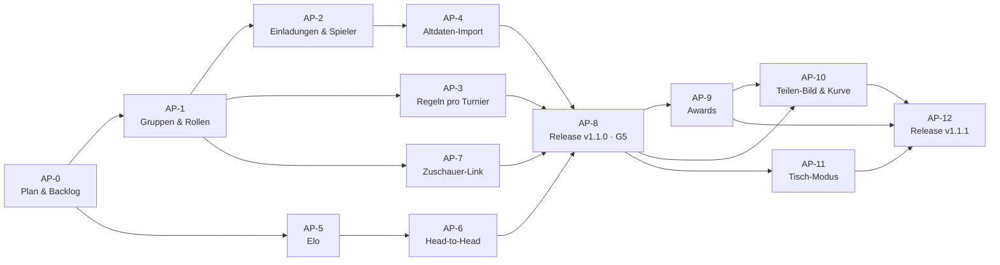

# Phase 5 – Gruppen & Altdaten (v1.1)

Stand: 27.11.2026 · Status: **geplant am 27.11.2026, Umsetzung ab 28.11.2026** (statt Januar 2027) · Entscheidungen E1 bis E8 (Abschnitt 6)

Phase 5 macht aus der App einer Gruppe eine App für mehrere Gruppen auf Einladung und holt die Geschichte der „Draft-Runde“ herein: alte Turniere aus Excel, Google Sheets und von Papier. Dazu kommen Elo und Head-to-Head, im zweiten Release Awards, Teilen-Bild, Lebenspunkte-Kurve und der Tisch-Modus.

**Gate G5:** Die Altdaten sind importiert, und eine zweite Gruppe kann TopStack nutzen. Die zweite Gruppe ist eine Testgruppe (E4): Sie wird in der Produktion angelegt, bekommt zwei Testkonten, spielt ein Turnier und sieht dabei nichts von der „Draft-Runde“.

Weitere Unterlagen zu dieser Phase:

| Dokument | Inhalt |
| --- | --- |
| [Roadmap, Phase 5](../roadmap.md#phase-5--release-v11-gruppen--altdaten) | Inhalt und Festlegungen aus der Befragung vom 22.11.2026 |
| [ADR-0018](../adr/0018-mehrere-gruppen.md) | Mehrere Gruppen in App und API: aktive Gruppe, Rollen, Archivieren, Zuschauer-Link |
| [ADR-0019](../adr/0019-wertungen-und-altdaten.md) | Elo, Head-to-Head und Awards aus der Historie; Altdaten als Importläufe |
| [ADR-0010](../adr/0010-mehrgruppen-datenmodell.md), [ADR-0015](../adr/0015-spieler-ohne-konto.md) | Grundlagen: Datenmodell für mehrere Gruppen, Spieler ohne Konto |

---

## 1. Ziele und Umfang

Die Phase endet mit zwei Releases (E1):

| Release | Inhalt | Gate |
| --- | --- | --- |
| **v1.1.0** | Gruppen mit Rollen und Regeln, Einladungen, Gast in Profil umwandeln, Spieler zusammenführen, Altdaten-Import, Elo, Head-to-Head, Zuschauer-Link | G5 |
| **v1.1.1** | Awards und Erfolge, Teilen-Bild, Lebenspunkte-Kurve, Tisch-Modus | – |

### Im Umfang

- Gruppen anlegen (höchstens 5 pro Nutzer), bearbeiten, archivieren, löschen (30 Tage wiederherstellbar), Gruppenbild
- Rollen Admin, Mitglied, Zuschauer; mehrere Admins; Umschalter zwischen Gruppen
- Gruppenregeln, die ab der nächsten Saison gelten; Abweichungen pro Turnier durch den Turnierstarter
- Gruppenlinks (7 Tage, mehrfach) für alle Mitglieder, Knopf „Persönlicher Link“ für Spieler ohne Konto
- Gast in Profil umwandeln (UC-18, UC-05), doppelte Spieler zusammenführen
- Altdaten per CSV und von Hand, pro Importlauf rücknehmbar (UC-19, UC-20)
- Elo pro Gruppe und global, Head-to-Head als Tabelle und Direktvergleich
- Zuschauer-Link für einen Abend
- Awards, Langzeit-Erfolge, „Bester der letzten 3 Drafts“, Abstimmung „Spieler des Abends“
- Teilen-Bild, Lebenspunkte-Kurve, Tisch-Modus fürs Tablet

### Bewusst nicht in Phase 5

- **Google-Login, Benutzername und Passwort:** gestrichen, weil niemand in der Gruppe sie braucht (E6). Issue bleibt im Backlog.
- Akzentfarbe der Gruppe (v3.1), Datenexport (v2.0), offene Registrierung (v4.0).
- Mehrere laufende Turniere **in einer** Gruppe (v1.4). Gleichzeitig in Turnieren verschiedener Gruppen geht ab v1.1.

---

## 2. Was schon da ist

| Bereich | Stand |
| --- | --- |
| Datenmodell | `play_group`, `group_rules`, `membership` mit `group_role` (admin, member, viewer), `player.kind` (member, guest, former, reserved), `season`, `tournament.imported`, Tabellen `elo_rating` und `award` (ungenutzt) |
| Gruppen | Nur „Draft-Runde“, angelegt mit `seed_group`. Kein Endpunkt zum Anlegen oder Bearbeiten |
| App | Turnier-Start und Startseite nehmen `me.groups[0]`; die Rangliste hat schon eine Gruppenauswahl |
| Rollen | Server prüft `admin` beim Einladen und Abbrechen, `viewer` beim Mitspielen; sonst nur Mitgliedschaft |
| Einladungen | `POST /groups/{gid}/invitations` nur für Admins; persönliche Links für vorgemerkte Spieler nur per `admin.sh invite-link` |
| Saisons | `admin.sh season-start`; Saison 2027 der „Draft-Runde“ beginnt am 01.12.2026 |
| Statistik | Rangliste pro Saison, Basis-Statistik je Spieler (Phase 3, AP-9) |
| Migrationen | bis `0004_feedback` |

---

## 3. Arbeitspakete

Jedes Arbeitspaket ist ein eigener Branch und mindestens ein Pull Request mit Auto-Merge (CLAUDE.md). Die Schätzungen sind Arbeitsstunden.

AP-1 kommt zuerst, weil fast alles danach die aktive Gruppe und die Rechteprüfung braucht. AP-5 (Elo) hängt nur am Plan und kann parallel laufen. AP-4 braucht das Zusammenführen aus AP-2, weil Ehemalige aus den Altdaten mit Konten verknüpft werden.

### AP-0 · Plan und Backlog (ca. 2 h) · Branch `docs/phase5-plan`

- [x] Fragen geklärt (27.11.2026), Entscheidungen E1 bis E8
- [x] Plan `docs/phase5/README.md`, ADR-0018 und ADR-0019
- [x] Roadmap aktualisiert (Phase 5 gestartet, Google-Login gestrichen)
- [x] `scripts/backlog.tsv` an den Versionsplan vom 22.11.2026 angepasst
- [x] GitHub aufgeräumt (E8, 27.11.2026): erledigte Issues aus Phase 3 und 4 geschlossen (#30–39 waren schon zu), Meilensteine Phase 1–4 geschlossen, „Hardware“ heißt jetzt v3.0, Meilensteine v1.1 bis v4.0 und „Backlog“ mit Fälligkeit nach Zeitplan, Issues verschoben. Ein Issue pro Arbeitspaket: AP-0 bis AP-12 sind #168 bis #180; die alten Funktions-Issues #87–95 sind darin aufgegangen. iPhone-Test #86 liegt jetzt in v1.1. `scripts/create-backlog-issues.sh` darf seitdem mehrfach laufen
- [ ] Altdaten zählen und sammeln: Excel- und Sheets-Dateien an einen Ort, Papier-Turniere zählen (Peter)

**Fertig, wenn:** Der Plan ist gemergt und das Backlog auf GitHub passt zum Plan.

### AP-1 · Gruppen und Rollen (ca. 8 h) · Branch `feat/p5-groups` · UC-01, ADR-0018

**Server**

- [x] Migration 0005: `play_group.archived_at`, `deleted_at`, `pending_rules`, `image`, `image_type` (`invitation.kind` kommt mit AP-7, wo es gebraucht wird)
- [x] `server/topstack/domain/groups.py`: Rechte-Tabelle (Admin, Mitglied, Zuschauer), Nachfolge für den letzten Admin, Höchstzahl 5 Gruppen pro Nutzer, Prüfung der Regeln, Saisonwechsel
- [x] `services/groups.access()` als gemeinsame Prüfung; Turniere, Rangliste und Einladungen nutzen sie; archivierte Gruppen nur lesbar (`409`)
- [x] Endpunkte: Gruppe anlegen (mit Standardregeln und Saison fürs laufende Jahr, Ersteller wird Admin und Spieler), lesen, umbenennen, Gruppenbild (höchstens 1 MB, JPEG/PNG/WebP; die App verkleinert auf 512 px), Regeln lesen und ändern, Mitglieder und Rollen, Gruppe verlassen, archivieren und zurückholen, löschen und wiederherstellen
- [x] Gruppen 30 Tage nach `deleted_at` endgültig löschen: Aufgabe in der API alle 6 Stunden statt im Backup-Timer (das Backup-Image hat kein Python)
- [x] Saisonwechsel übernimmt `pending_rules`: Der Turnier-Start legt die fehlende Saison selbst an (bisher entstanden Saisons nur von Hand); ohne Turniere gelten Regeln sofort
- [x] API-Tests je Rolle (`tests/api/test_groups.py`, TC-130 bis TC-139), Fachlogik in `tests/domain/test_groups.py`

**App**

- [x] Aktive Gruppe pro Gerät (`localStorage`), Umschalter in Turnieren und Rangliste ab zwei Gruppen; alle `me.groups[0]` ersetzt
- [x] Bildschirm „Gruppe“ (`/gruppe/<id>`): Name, Bild, Mitglieder mit Rolle, alle Spieler, Regeln mit „ab der nächsten Saison“, Archivieren, Löschen, Verlassen; Admin-Teile nur für Admins
- [x] „Neue Gruppe“ und Papierkorb mit „Wiederherstellen“ im Profil
- [x] Zuschauer und archivierte Gruppen: kein Turnier-Start, keine Spielerliste
- [x] Unit-Tests (`domain/activeGroup.test.ts`), E2E `e2e/groups.spec.ts`: umschalten, archiviert, Gruppe anlegen mit Regeln und Rollen, Mitglied ohne Verwaltung. Turnier in zwei Gruppen gleichzeitig prüft der API-Test TC-133
- [ ] Auf Beta ausprobiert (nach dem Merge)

**Fertig, wenn:** Ein Nutzer legt eine zweite Gruppe an, schaltet um und startet dort ein Turnier, während in der „Draft-Runde“ eins läuft.

### AP-2 · Einladungen und Spieler (ca. 6 h) · Branch `feat/p5-players` · UC-05, UC-18

- [x] Gruppenlinks für alle Mitglieder: 7 Tage gültig, mehrfach nutzbar; Liste offener Links mit „Zurückziehen“ (Admins sehen alle, Mitglieder ihre eigenen)
- [x] Knopf „Persönlicher Link“ bei Spielern ohne Konto (einmalig, nutzt `invitation.player_id`, ADR-0015); nur Admins
- [x] Gast in Profil umwandeln (UC-18): Nach dem Beitritt als Gast kommt sofort das Angebot „Profil anlegen“ (UC-05) mit einem persönlichen Link (30 Tage). Wer ihn annimmt, übernimmt den Gast-Spieler mit seinen Ergebnissen und wird Mitglied. Hat er schon ein Konto in der Gruppe, bleibt alles, und das Admin führt beide zusammen
- [x] Spieler zusammenführen (Admin, im Bildschirm „Gruppe“, erst Vorschau): Gast, Vorgemerkter oder Ehemaliger geht in einen anderen Spieler auf. Einträge, Matches, Spiele, Ereignisse, Korrekturen und Awards wechseln; verweigert, wenn beide im selben Turnier stehen oder der Spieler, der aufgeht, ein Konto hat
- [x] Zusammenführen auch als `admin.sh merge-player <von> <nach> [--apply]`, mit Backup vorher
- [x] Tests: `tests/api/test_players.py` (TC-140 bis TC-144), E2E in `e2e/groups.spec.ts`
- [ ] Auf Beta ausprobiert (nach dem Merge)

**Fertig, wenn:** Ein Gast aus einem Turnier wird zu einem Profil und steht mit seinem Ergebnis in der Rangliste; zwei doppelte Spieler sind zusammengeführt.

### AP-3 · Regeln pro Turnier (ca. 3 h) · Branch `feat/p5-tournament-rules`

- [x] Beim Turnier-Start: Matchformat (Best-of-1/3/5), Zeitlimit, Startleben und Matchpunkte aus den Gruppenregeln vorbelegt, für dieses Turnier änderbar (`tournament.settings["rules"]`, nur Abweichungen)
- [x] Abweichungen in der Turnier-Ansicht sichtbar („Eigene Regeln: Best-of-1 · 30 Leben“)
- [x] Spielplan (Zeitlimit), Tabelle (Matchpunkte), Life-Tracker (Startleben, Matchende), Ergebnisprüfung, Ranglistenpunkte und die Matchpunkte der Rangliste nutzen die Regeln des Turniers (`services/tournaments.rules_for`)
- [x] Tests: `tests/api/test_tournament_rules.py` (TC-145), Rangliste mit eigenen Matchpunkten, Unit-Tests für Ergebnis-Auswahl und Abweichungen, E2E „Turnier mit eigenen Regeln starten“
- [ ] Auf Beta ausprobiert (nach dem Merge)

**Fertig, wenn:** Ein Turnier mit Best-of-1 und 30 Leben läuft durch und zählt richtig.

### AP-4 · Altdaten-Import (ca. 10 h) · Branch `feat/p5-import` · UC-19, UC-20, ADR-0019

**Server**

- [x] Migration 0006: `import_run`, `tournament.import_run_id`
- [x] CSV-Prüfung ohne Speichern (Komma oder Semikolon): Pflichtfelder Datum, Spieler, Platz; Set und Matches optional; leer oder „?“ wird `UNK` (keine Liste offizieller Kürzel, Draft-Namen wie „Cube“ bleiben erlaubt); Fehlerliste mit Zeilennummer; Namensabgleich mit vorhandenen Spielern, neue Namen werden Ehemalige
- [x] Übernehmen in einer Transaktion; Turniere zählen in die Saison ihres Datums und in die ewige Tabelle, nicht in die Elo
- [x] Importlauf zurücknehmen
- [x] Tests mit den Beispiel-CSVs aus der Roadmap, mit Fehlern, mit Rücknahme (`tests/domain/test_legacy.py`, `tests/api/test_imports.py`)

**App (nur Admins)**

- [x] Bildschirm „Altdaten“ (Gruppe → Verwalten): CSV-Vorlagen herunterladen, zwei Dateien hochladen, Vorschau (Turniere, Spieler, neue Ehemalige, Fehler), Übernehmen, Liste der Läufe mit „Zurücknehmen“
- [x] Formular für ein einzelnes Turnier (Papier): Datum, Set, Teilnehmer mit Platz (Matches nur über die API)
- [x] Importierte Turniere mit Kennzeichen „importiert“ in Turnierliste und Turnier-Ansicht; Tabelle folgt den Plätzen aus den Unterlagen. Offen: Die Turnierliste zeigt nur die neuesten 20
- [x] E2E: Import mit Vorschau, Übernehmen, Rücknahme

**Altdaten (Peter)**

- [ ] Excel und Sheets in die CSV-Vorlage bringen, auf Beta probeweise importieren
- [ ] In der Produktion importieren, Ehemalige mit Konten zusammenführen
- [ ] Papier-Turniere von Hand eintragen (bis Ende von Phase 5)

**Fertig, wenn:** Alle digitalen Altdaten sind in der Produktion, die ewige Tabelle stimmt mit den Unterlagen überein, und ein Probeimport auf Beta ließ sich vollständig zurücknehmen.

### AP-5 · Elo (ca. 5 h) · Branch `feat/p5-elo` · F-19, ADR-0019

- [x] `server/topstack/domain/elo.py`: reine Funktion über die sortierten Matches; Start 1000, K = 40 für die ersten 10 Matches, danach 32; Unentschieden 0,5; Gäste und importierte Turniere zählen nicht; alle Matches seit v1.0 (E5)
- [x] Gruppen-Elo je Spieler, globale Elo je Konto (`services/elo.py`); ohne Zwischenspeicher, weil die Rechnung bei einigen hundert Matches Millisekunden dauert
- [x] Migration 0007: `elo_rating` entfernen
- [x] Anzeige nach Entwurf B (28.11.2026): Rangliste mit Umschalter „Punkte“/„Elo“, Elo-Leiter mit Mini-Kurve; in der Spielerstatistik Vergleich mit mir (was ein Sieg oder eine Niederlage brächte) und die letzten Matches mit Elo-Änderung. Ein eigener Profil-Bildschirm mit Statistik fehlt noch, deshalb sitzt der Vergleich in der Statistik-Karte der Rangliste
- [x] Unit-Tests mit von Hand gerechneten Beispielen (Sieg, Unentschieden, K-Wechsel nach 10 Matches, Korrektur rechnet neu)

**Fertig, wenn:** Die Rangliste zeigt die Elo, und eine Ergebniskorrektur ändert sie sofort.

### AP-6 · Head-to-Head (ca. 4 h) · Branch `feat/p5-h2h` · F-22

- [x] Endpunkte `/groups/{gid}/head-to-head` (alle Paarungen) und `…/head-to-head/{a}/{b}` (Bilanz, Spiele, letzte 10 Begegnungen, Elo beider)
- [x] Importierte Matches zählen mit und sind markiert
- [x] App nach Entwurf B (28.11.2026): Rangliste → „Duelle“ mit Rivalen-Liste und Angstgegner, Duell als Anzeigetafel; aus der Statistik eines Spielers „Duell mit … ansehen“. Offen: Pause-Ansicht für den nächsten Gegner
- [x] Tests: Bilanz mit Unentschieden, ohne gemeinsame Matches (TC-154), Rivalen-Liste, E2E

**Fertig, wenn:** Aus jedem Profil öffnet sich der Direktvergleich mit mir.

### AP-14 · Stabile Updates (ca. 5 h) · Branch `feat/p5-stable-updates` · N-07, ADR-0021, ergänzt am 28.11.2026, **vor AP-7**

Anlass: Beta hing auf PC und Handy tagelang auf Update #164, weil Cloudflare Access nach Ablauf der Sitzung auch `sw.js` blockierte.

**Cloudflare und Betrieb (Peter)**

- [x] Access-Anwendung „TopStack Beta“ nur noch für `beta.topstack.win/api` und `/ws`, „TopStack Beta – App“ (Bypass) für den Rest; geprüft ohne Anmeldung: App-Dateien 200, API und `/ws` leiten zur Anmeldung um (28.11.2026)
- [x] Cloudflare „Browser Cache TTL“ auf „Respect Existing Headers“, damit `sw.js` mit `no-cache` ankommt (28.11.2026)
- [x] Uptime Kuma: Monitor „Beta App“ auf `https://beta.topstack.win/sw.js`, ohne Anmeldung, erwartet 200; online mit ntfy (28.11.2026)

**App**

- [x] Update-Nummer der App mit `build.pr` aus `/api/v1/health` vergleichen, beim Start und beim Zurückkehren in die App
- [x] Service Worker beim Öffnen und alle 30 Minuten aktiv nach Updates fragen (`registration.update()`)
- [x] Hinweis „Neue Version da“ mit Knopf oben im Seitenfluss (verdeckt keine Knöpfe); während eines laufenden Matches erst danach; hilft Neuladen nicht, bietet er „App zurücksetzen“ an
- [x] Abgelaufene Access-Anmeldung: Hinweis, Knopf führt zur Anmeldung und zurück an dieselbe Stelle; Life-Tracker läuft offline weiter
- [x] „App zurücksetzen“ im Profil und im Offline-Hinweis: Service Worker abmelden, Zwischenspeicher leeren, neu laden; IndexedDB (Spielstände, Outbox) und Anmeldung bleiben

**Prüfung**

- [x] E2E „veraltete App“ und „Access abgelaufen“ (TC-163, TC-164, TC-166); E2E-Builds tragen Update #100 (`vite --mode e2e`)
- [x] Smoke-Test in der CI: `sw.js`, `index.html`, `/assets` im Staging-Stack mit den erwarteten Cache-Headern (TC-165)
- [x] Anleitung in `docs/phase3/heimserver.md`, Abschnitt „Access nur vor der API“ (Access-Pfade, Monitor)

**Fertig, wenn:** Nach abgelaufener Access-Sitzung zeigt Beta auf dem Handy ohne Löschen von Website-Daten die neueste Version, und „App zurücksetzen“ behält einen laufenden Spielstand. **Erledigt am 28.11.2026:** Handy nach einmaligem Aufräumen auf dem neuen Stand, Access und Cache geprüft.

### AP-15 · Profilbilder (ca. 6 h) · Branch `feat/p5-avatars` · ergänzt am 28.11.2026, **vor AP-7**

Wunsch aus dem Beta-Test: Profilbilder mit Namen in der Siegerehrung, eine lustige Vorauswahl und eigene Bilder. Festlegungen vom 28.11.2026:

- **Vorauswahl:** ca. 16 eigene Fantasy-Wesen als SVG im Stil „Dunkel & Gold“, je in einer Manafarbe (keine Kunst von Wizards of the Coast); erst als Entwurf zur Auswahl (ADR-0020)
- **Eigene Bilder:** PNG oder JPEG, im Handy quadratisch/rund zuschneiden, auf 256 px verkleinert; liegen nur auf dem Heimserver, nie in GitHub; änderbar und löschbar
- **Ein Bild je Konto** für alle Gruppen (wie Anzeigename und Lieblingsfarben)
- **Spieler ohne Konto:** Der Gruppen-Admin wählt für vorgemerkte Spieler ein Bild aus der Vorauswahl; Gäste und alle ohne Wahl bekommen Initialen auf einem Kreis in ihren Farben
- **Anzeige:** Siegerehrung (groß über dem Namen), Rangliste, Elo-Leiter, Duelle, Turnier-Tabelle, Spielplan und Live-Ansicht

**Aufgaben**

- [ ] Entwurf der Fantasy-Wesen, Auswahl durch Peter
- [ ] Server: Bild je Konto (Vorauswahl-Schlüssel oder eigenes Bild), Bild je vorgemerktem Spieler (nur Vorauswahl, Admin); Endpunkte zum Setzen, Löschen und Ausliefern; Prüfung von Typ und Größe; Migration
- [ ] Spieler- und Turnier-Antworten liefern das Bild mit (Schlüssel oder Adresse)
- [ ] App: Auswahl im Profil (Vorauswahl oder Hochladen mit Zuschnitt), Admin-Auswahl in „Gruppe“ bei Spielern ohne Konto
- [ ] Baustein `Avatar` mit Initialen als Rückfall; eingebaut in Siegerehrung, Rangliste, Elo-Leiter, Duelle, Turnier-Tabelle, Spielplan, Live-Ansicht
- [ ] Tests: Upload mit falschem Typ oder zu groß, Rückfall auf Initialen, E2E Auswahl und Anzeige in der Siegerehrung

**Fertig, wenn:** Die Siegerehrung zeigt auf dem Handy Bild und Name aller drei Plätze, auch für einen Spieler ohne Konto.

### AP-7 · Zuschauer-Link (ca. 3 h) · Branch `feat/p5-spectator`

- [ ] Mitglieder erzeugen für ein laufendes Turnier einen Zuschauer-Link (`invitation.kind = 'spectator'`), gültig bis 6 Uhr am nächsten Morgen
- [ ] Öffentliche, nur lesende Live-Ansicht ohne Anmeldung: Tabelle, laufende Matches, Lebenspunkte; keine Profile, keine Knöpfe
- [ ] WebSocket-Thema `tournament:<id>` auch für Zuschauer-Token, nur lesend
- [ ] Tests: abgelaufener Link, Schreibversuch mit Zuschauer-Token, QR-Code

**Fertig, wenn:** Ein Handy ohne Konto verfolgt das Turnier live über den Link.

### AP-8 · Release v1.1.0 und Gate G5 (ca. 2 h)

- [ ] `v1.1.0-rc.1` auf Beta, Testturnier in zwei Gruppen
- [ ] „Was ist neu“ für v1.1.0
- [ ] Release `v1.1.0`, Produktion holt es selbst
- [ ] Abnahme G5: Altdaten in der Produktion (AP-4), Testgruppe mit zwei Testkonten spielt ein Turnier und sieht nichts von der „Draft-Runde“, die „Draft-Runde“ sieht nichts von ihr; danach die Testgruppe archivieren

**Fertig, wenn:** G5 ist abgenommen.

### AP-9 · Awards und Erfolge (ca. 6 h) · Branch `feat/p5-awards`

- [ ] Award-Liste aus der Roadmap (Phönix, Zitterpartie, Blitzsieg, Marathon, Dampfhammer, Ungeschlagen, Glückspilz, Pechvogel, Regenbogen, Purist); welche aktiv sind, entscheidet die Gruppe in AP-9 (Frage an die Gruppe)
- [ ] Berechnung beim Turnierende aus den Ereignissen, gespeichert in `award`; `admin.sh awards <Turnier>` rechnet neu
- [ ] Abstimmung „Spieler des Abends“ nach dem Turnierende bis 6 Uhr am nächsten Morgen, eine Stimme pro Teilnehmer, nicht für sich selbst (`award_vote`)
- [ ] Langzeit-Erfolge und „Bester der letzten 3 Drafts“ im Profil
- [ ] Anzeige in der Siegerehrung und im Profil
- [ ] Unit-Tests je Award mit erfundenen Ereignissen

**Fertig, wenn:** Nach einem Turnier zeigt die Siegerehrung die Awards des Abends.

### AP-10 · Teilen-Bild und Lebenspunkte-Kurve (ca. 4 h) · Branch `feat/p5-share`

- [ ] Teilen-Bild in der App (Canvas, kein Server): Podium, Set, Datum, Awards; „Teilen“ über die Web Share API, sonst Herunterladen
- [ ] Lebenspunkte-Kurve je Spiel aus den Ereignissen, im Match-Verlauf und nach dem Spiel
- [ ] Tests: Kurve aus Ereignissen mit Rückgängig, Bild in der E2E-Emulation

**Fertig, wenn:** Das Teilen-Bild landet aus der App im Gruppenchat.

### AP-11 · Tisch-Modus (ca. 4 h) · Branch `feat/p5-table`

- [ ] Querformat fürs Tablet: Tabelle, laufende Matches mit Lebenspunkten, Timer, Tischgrafik; bleibt an (Wake Lock), keine Bedienung nötig
- [ ] Erreichbar aus der Live-Ansicht; auch mit Zuschauer-Link (AP-7)
- [ ] E2E mit Tablet-Viewport

**Fertig, wenn:** Das Tablet zeigt einen ganzen Abend lang den Stand, ohne dass jemand tippt.

### AP-13 · Ruhe im Match (ca. 4 h) · Branch `feat/p5-quiet-match` · N-06, ergänzt am 28.11.2026

- [ ] Server hält Push-Nachrichten an ein Konto zurück, solange dessen Match läuft, und schickt sie nach Matchende gesammelt; Ausnahme: Abbruch beantragt
- [ ] Hinweis „Nicht stören einschalten?“ beim Matchstart mit Anleitung für Android und iPhone, „Nicht mehr zeigen“
- [ ] Bildschirm bleibt in der Turnier-Ansicht an, solange man im laufenden Turnier mitspielt; Hinweis, wenn das Handy die Sperre verweigert
- [ ] Life-Tracker ohne Tasten im oberen Rand (Banner anderer Apps)
- [ ] Tests: zurückgehaltene Push-Nachricht kommt nach Matchende, Hinweis nur einmal

**Fertig, wenn:** Während eines Matches kommt keine Nachricht von TopStack, und der Bildschirm bleibt im ganzen Turnier an.

### AP-12 · Release v1.1.1 (ca. 1 h)

- [ ] „Was ist neu“, Release `v1.1.1`
- [ ] Roadmap und Plan auf „abgeschlossen“

**Fertig, wenn:** v1.1.1 läuft in der Produktion.

---

## 4. Testfälle

| ID | Fall | Erwartung | AP | Prio |
| --- | --- | --- | --- | --- |
| TC-130 | Gruppe anlegen | Ersteller ist Admin und Spieler, Standardregeln, erste Saison angelegt | AP-1 | hoch |
| TC-131 | Höchstzahl | Sechste eigene Gruppe wird abgelehnt | AP-1 | mittel |
| TC-132 | Umschalten | App öffnet die zuletzt genutzte Gruppe; Startseite, Rangliste, Turnier-Start folgen dem Umschalter | AP-1 | hoch |
| TC-133 | Zwei Turniere | In Gruppe A und B läuft je ein Turnier, derselbe Spieler spielt in beiden | AP-1 | hoch |
| TC-134 | Zuschauer-Rolle | Sieht Live, Rangliste, Statistik; keine Profile, kein Mitspielen, Schreibzugriffe `403` | AP-1 | hoch |
| TC-135 | Letzter Admin geht | Ältestes Mitglied wird Admin | AP-1 | mittel |
| TC-136 | Archivieren | Gruppe nur lesbar, Schreiben `409`; zurückholen möglich | AP-1 | mittel |
| TC-137 | Löschen | Gruppe ausgeblendet, 30 Tage wiederherstellbar, danach endgültig weg | AP-1 | mittel |
| TC-138 | Regeländerung | Neue Regeln gelten erst ab der nächsten Saison | AP-1 | hoch |
| TC-139 | Getrennte Gruppen | Mitglied von A sieht von B weder Turniere noch Spieler noch Rangliste (API `404`) | AP-1 | hoch |
| TC-140 | Gruppenlink | Jedes Mitglied erzeugt ihn; 7 Tage gültig, mehrfach nutzbar, zurückziehbar | AP-2 | hoch |
| TC-141 | Persönlicher Link | Aus der App; einmal nutzbar, übernimmt den vorgemerkten Spieler mit allen Ergebnissen | AP-2 | hoch |
| TC-142 | Gast wird Profil | Nach dem Beitritt Angebot „Profil anlegen“; Ergebnis steht danach in der Rangliste | AP-2 | hoch |
| TC-143 | Zusammenführen | Zwei Spieler werden einer, Rangliste und Statistik zählen alles einmal | AP-2 | hoch |
| TC-144 | Zusammenführen verweigert | Beide im selben Turnier → Fehler mit Turniername | AP-2 | mittel |
| TC-145 | Abweichende Regeln | Best-of-1 und 30 Leben für ein Turnier, Tracker und Tabelle richtig | AP-3 | hoch |
| TC-146 | CSV prüfen | Vorschau mit Turnieren, neuen Ehemaligen und Fehlern mit Zeilennummer; nichts gespeichert | AP-4 | hoch |
| TC-147 | CSV übernehmen | Turniere mit „importiert“, Saison nach Datum, ewige Tabelle stimmt | AP-4 | hoch |
| TC-148 | Import zurücknehmen | Alle Turniere des Laufs und ungenutzte Ehemalige sind weg, Rangliste wie vorher | AP-4 | hoch |
| TC-149 | Turnier von Hand | Papier-Turnier mit Platzierungen ohne Matches eingetragen | AP-4 | mittel |
| TC-150 | Unbekanntes Set | Set fehlt oder unbekannt → `UNK`, kein Fehler | AP-4 | niedrig |
| TC-151 | Elo-Rechnung | Werte stimmen mit von Hand gerechneten Beispielen überein (K = 40, dann 32, Unentschieden) | AP-5 | hoch |
| TC-152 | Elo ohne Gäste und Altdaten | Matches gegen Gäste und importierte Turniere ändern die Elo nicht | AP-5 | hoch |
| TC-153 | Elo nach Korrektur | Ergebnis korrigiert → Elo sofort neu | AP-5 | mittel |
| TC-154 | Head-to-Head | Bilanz zweier Spieler mit Matches, Spielen, Unentschieden, importierte markiert | AP-6 | hoch |
| TC-155 | Zuschauer-Link | Ohne Konto Live-Ansicht mit Lebenspunkten; nach 6 Uhr ungültig | AP-7 | hoch |
| TC-156 | Zuschauer schreibt | Jeder Schreibversuch mit Zuschauer-Token `401`/`403` | AP-7 | hoch |
| TC-157 | Awards | Nach Turnierende erscheinen die Awards aus den Ereignissen in der Siegerehrung | AP-9 | hoch |
| TC-158 | Spieler des Abends | Eine Stimme pro Teilnehmer, nicht für sich selbst, Ergebnis nach Ablauf | AP-9 | mittel |
| TC-159 | Teilen-Bild | Bild mit Podium, Set, Datum, Awards; Teilen auf Android und iPhone | AP-10 | mittel |
| TC-160 | Lebenspunkte-Kurve | Kurve entspricht den Ereignissen, Rückgängig berücksichtigt | AP-10 | mittel |
| TC-161 | Tisch-Modus | Tablet zeigt Tabelle, Matches, Timer, Tischgrafik; Bildschirm bleibt 30 Minuten an | AP-11 | mittel |
| TC-162 | Gate G5 | Testgruppe spielt ein Turnier, beide Gruppen sehen sich gegenseitig nicht | AP-8 | hoch |
| TC-163 | Veraltete App | Server meldet neuere Update-Nummer → Hinweis „Neue Version da“, Knopf lädt die neue Version; während eines Matches erst danach | AP-14 | hoch |
| TC-164 | Access abgelaufen | API leitet zu Cloudflare um → Hinweis, Knopf führt zur Anmeldung und zurück; Life-Tracker weiter nutzbar | AP-14 | hoch |
| TC-165 | App-Dateien ohne Anmeldung | `sw.js`, `index.html`, `/assets` auf Beta ohne Access ladbar, `sw.js` mit `no-cache` | AP-14 | hoch |
| TC-166 | App zurücksetzen | Zwischenspeicher und Service Worker weg, laufender Spielstand und Anmeldung bleiben | AP-14 | hoch |
| TC-167 | Update nach langer Pause | Handy 2 Tage nicht genutzt, Access abgelaufen → nach dem Öffnen und der Anmeldung neueste Version ohne Daten löschen | AP-14 | mittel |
| TC-168 | Profilbild aus Vorauswahl | Im Profil ein Wesen wählen → erscheint in Siegerehrung, Rangliste und Live-Ansicht | AP-15 | hoch |
| TC-169 | Eigenes Profilbild | PNG oder JPEG hochladen, Ausschnitt wählen → 256 px, auf allen Geräten sichtbar; GIF oder zu große Dateien abgelehnt | AP-15 | hoch |
| TC-170 | Spieler ohne Konto | Admin wählt für einen vorgemerkten Spieler ein Wesen; Gäste zeigen Initialen | AP-15 | mittel |
| TC-171 | Bild entfernen | Bild löschen → Initialen; die Datei ist auf dem Server weg | AP-15 | mittel |

---

## 5. Zeitplan

Bei etwa 6 Stunden pro Woche, Start am 28.11.2026 (E3). Der Draftabend am 27.12.2026 läuft mit v1.0.x; die Arbeit auf Beta stört ihn nicht.

| Woche | Arbeitspakete | Summe |
| --- | --- | --- |
| 1–2 (ab 28.11.) | AP-0, AP-1 | 10 h |
| 3 | AP-2 | 6 h |
| 4 (Draftabend 27.12.) | AP-3, AP-5 | 8 h |
| 5–6 | AP-4 | 10 h |
| 7 | AP-6, AP-7 | 7 h |
| 8 | AP-8 · **v1.1.0** | 2 h |
| 9–10 | AP-9, AP-10 | 10 h |
| 11 | AP-11, AP-12 · **v1.1.1** | 5 h |
| **gesamt** | | **ca. 58 h** (dazu AP-13 4 h, AP-14 5 h) |

v1.1.0 also etwa Ende Januar 2027, v1.1.1 Mitte Februar 2027.

---

## 6. Entscheidungen

Befragung vom 27.11.2026:

| Nr. | Frage | Entscheidung |
| --- | --- | --- |
| E1 | Wie kommen die Funktionen in die Produktion? | Zwei Releases: v1.1.0 mit Gruppen, Altdaten, Elo, Head-to-Head und Zuschauer-Link (Gate G5), danach v1.1.1 mit Awards, Teilen-Bild, Kurve und Tisch-Modus. v1.1.1 trägt bewusst neue Funktionen, weil v1.2 für die Terminumfrage reserviert ist |
| E2 | Wie viele Alt-Turniere? | 30 bis 150; CSV-Import lohnt sich, Papier von Hand |
| E3 | Wann beginnt Phase 5? | Sofort, am 28.11.2026 statt im Januar 2027 |
| E4 | Zweite Gruppe für G5? | Keine konkrete; G5 wird mit einer Testgruppe in der Produktion abgenommen |
| E5 | Elo ab wann? | Alle Matches seit v1.0, auch die Testturniere aus Phase 3 und 4; ohne Gäste und Altdaten |
| E6 | Google-Login, Benutzername und Passwort? | Gestrichen, niemand braucht es; Issue bleibt im Backlog |
| E7 | Wie läuft der Import? | In der App für Admins: CSV mit Vorschau und Rücknahme, Formular für einzelne Turniere |
| E8 | Backlog auf GitHub? | Komplett aufräumen: Doppelte schließen, Meilensteine nach Versionsplan, ein Issue pro Arbeitspaket |

**Frontend-Design** (Befragung vom 28.11.2026, 30 Fragen, festgehalten in [ADR-0020](../adr/0020-frontend-design.md)):

| Nr. | Frage | Entscheidung |
| --- | --- | --- |
| F1 | Einsatz des Plugins `frontend-design` | Neue Bildschirme von Phase 5 und bestehende überarbeiten |
| F2 | „Dunkel & Gold“ | Weiterentwickeln |
| F3 | Ablauf | Erst Entwurf zum Anschauen, dann bauen |
| F4 | Ab wann | Ab sofort, ab AP-5 |
| F5 | Stimmung | Edel und ruhig |
| F6 | Magic-Bezug | Dezent: Manafarben und -symbole |
| F7 | Schriften | Inter plus Display-Schrift für Überschriften und große Zahlen |
| F8 | Farben außer Gold | Nur Manafarben für Spieler |
| F9 | Hell/Dunkel | Nur dunkel |
| F10 | Barrierefreiheit | WCAG AA |
| F11 | Bedienung | Hauptaktion unten, Tippflächen ≥ 48 px |
| F12 | Bewegung reduzieren | Respektieren |
| F13 | Umfang Animation | Gezielt an Höhepunkten |
| F14 | Wo Animation | Siegerehrung und Awards, Würfeln und Auslosung |
| F15 | Vibration/Ton | Vibration wie bisher, keine Töne |
| F16 | Ladezustände | Platzhalter-Gerüst (Skeleton) |
| F17 | Geräte | Android-Handy im Fokus |
| F18 | Breite Bildschirme | Mobile-first, Tabellen und Import breiter |
| F19 | Navigation | Untere Tab-Leiste |
| F20 | Querformat | Nur im Life-Tracker |
| F21 | Überarbeitung zuerst | Turnier-Ansicht, Startseite, Rangliste & Statistik, Profil & Gruppe |
| F22 | Life-Tracker | Nur Feinschliff |
| F23 | Statistik | Tabellen plus kleine Diagramme |
| F24 | Diagramme | Eigenes SVG |
| F25 | Styling-Technik | Eigene CSS-Tokens weiter |
| F26 | Icons | Lucide, Mana-Symbole, eigene SVGs |
| F27 | Bilder | Gruppenbild und Avatare, später Scryfall-Kartenbilder |
| F28 | Leere Zustände | Mit nächstem Schritt, kein Onboarding |
| F29 | Prüfung | Screenshots im PR und visuelle Regressionstests |
| F30 | Tonfall | Du, freundlich-knapp |

Aus der Roadmap übernommen (Befragung vom 22.11.2026): höchstens 5 Gruppen pro Nutzer, mehrere Admins, alle Mitglieder laden ein, Links 7 Tage, persönliche Links einmalig, Archivieren und Löschen mit 30 Tagen, Regeln ab der nächsten Saison, Zuschauer ohne Profile, zuletzt genutzte Gruppe mit Umschalter.

---

## 7. Definition of Done (für jedes Arbeitspaket)

- [ ] Akzeptanzkriterien erfüllt, Testfälle aus Abschnitt 4 bestanden
- [ ] Server-Änderungen mit Tests gegen echtes PostgreSQL, neue Rechte mit API-Tests je Rolle
- [ ] Neue Bildschirme mit Unit- und E2E-Test
- [ ] Datenbankänderungen per Migration, `docs/schema.sql` und `docs/datenmodell.md` angepasst
- [ ] CI grün, Auto-Merge an
- [ ] Eintrag im Changelog
- [ ] Auf Beta ausprobiert

---

## 8. Risiken

| Risiko | Auswirkung | Gegenmaßnahme |
| --- | --- | --- |
| Rechteprüfung lückenhaft | Gruppe B sieht Daten von Gruppe A | Eine gemeinsame Prüfung `group_access()`, API-Tests je Rolle und Endpunkt, TC-139 |
| Altdaten unvollständig oder widersprüchlich | Ewige Tabelle falsch | Vorschau mit Fehlerliste, Probeimport auf Beta, Rücknahme pro Lauf |
| Zusammenführen trifft falsche Spieler | Ergebnisse beim falschen Namen | Vorschau ohne `--apply`, Backup vorher, nur Admins |
| Elo der Testturniere verzerrt | Unfaire Startwerte | Gelöschte Testturniere zählen nicht; Elo wird jederzeit neu berechnet, eine spätere Regel ist leicht zu ändern |
| Phase zu groß für 6 h pro Woche | v1.1.0 verzögert sich | Zwei Releases (E1); AP-9 bis AP-11 können wandern, ohne G5 zu berühren |
| Migration in der Produktion schlägt fehl | Ausfall | Backup vor jedem Deployment, Rollback (ADR-0016), jede Migration erst auf Beta |
